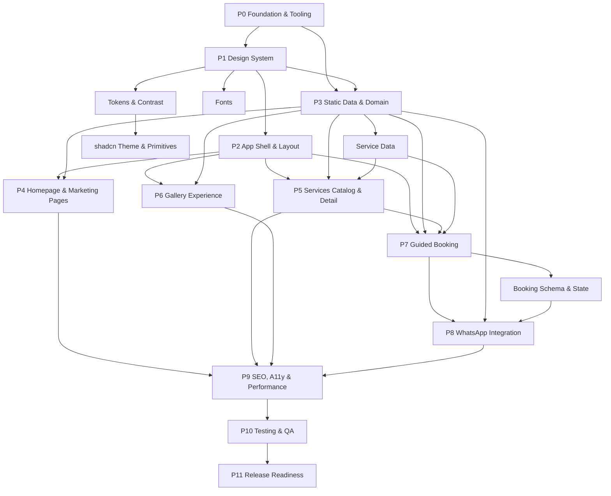

# IMPLEMENTATION-PLAN.md — Maison Belle

**Status:** Rencana implementasi final setelah klarifikasi  
**Versi:** 1.0  
**Tanggal:** 5 November 2026  
**Sumber keputusan:** `PRD.md`, `SPEC.md`, `ARCHITECTURE.md`, `design/DESIGN-BRIEF.md`, `design/DESIGN-DIRECTION.md`, `design/DESIGN-SYSTEM.md`, keputusan pengguna Q-001 sampai Q-010.  
**Mode:** Plan mode pada saat penyusunan; implementasi dijalankan setelah persetujuan pengguna.

---

## Status Implementasi (5 November 2026)

| Fase | Status | Bukti |
| --- | --- | --- |
| P0 Foundation & Tooling | Selesai | pnpm, Node 24 pin, Vitest/RTL/Playwright, config, README |
| P1 Design System | Selesai | Token, Playfair/DM Sans, primitive, kontras |
| P2 App Shell | Selesai | Root/marketing/booking layout, header, mobile sheet, footer, 404/error |
| P3 Static Data & Domain | Selesai | 12 layanan aktif + 1 nonaktif, gallery, artist, testimonial, FAQ, config, format, 17 aset stock |
| P4 Homepage & Marketing Pages | Selesai | Homepage, about, contact, privacy |
| P5 Services | Selesai | Katalog, filter, detail, metadata, 404 |
| P6 Gallery | Selesai | Filter, masonry, lightbox keyboard/focus |
| P7 Guided Booking | Selesai | Step 1–4, schema, state, calendar, form, summary |
| P8 WhatsApp | Selesai | Message/URL builder, step 5, copy fallback, invalid-config fallback |
| P9 SEO/A11y/Perf | Selesai | Metadata, canonical, sitemap, robots, OG, structured data, axe; Lighthouse desktop 99/100/100/100, mobile 83/100/100/100 |
| P10 Testing & QA | Selesai | 39 unit/component tests, 28 Playwright checks (Chromium desktop + mobile), build/lint/typecheck; Chrome DevTools trace desktop LCP 0.68 s, mobile LCP 2.57 s (4x CPU, Fast 4G), CLS 0.00 |
| P11 Release Readiness | Sebagian | Case study + screenshot dibuat; Vercel/domain/real WhatsApp number belum dikonfigurasi |

**Deviations:** shadcn-style primitives ditulis manual (bukan CLI), gallery memakai ulang foto layanan sehingga total 17 aset bukan 29, WebKit belum dijalankan, dan deployment eksternal belum dilakukan. Semua deviasi tidak mengubah ruang lingkup MVP. Lighthouse mobile Performance turun dari 91 ke 83 setelah cinematic motion dan dark mode, sesuai prioritas animasi yang disetujui pengguna; desktop tetap 99.

**Post-MVP cinematic motion (A0–A8, approved):** logo owner diintegrasikan, image curation, hero parallax dan masked text reveal, repeat-on-scroll section reveal, staggered grids, image clip reveal, hover motion di seluruh permukaan interaktif, full-screen gallery lightbox dengan thumbnail dan layout transition, full-screen mobile menu, booking progress/step transition/sticky action bar, surface grain, workflow section, page transition 8 px/250 ms, dan Motion for React dengan async `LazyMotion` + `domMax`. Semua efek berjalan di mobile dan desktop; `prefers-reduced-motion` mematikan motion non-esensial.

**Post-MVP dark mode (approved):** light/dark theme dengan `next-themes`, default mengikuti sistem, pilihan manual disimpan di `localStorage`, toggle di header dan menu mobile, serta native View Transition radial reveal. Reduced motion dan browser tanpa View Transition memakai pergantian instan. Token `canvas`, `surface`, `field`, `deep`, `action-fill`, dan `on-action` menjaga kontras di kedua tema.

---

## 1. Ringkasan Eksekutif

Maison Belle akan dibangun sebagai website marketing **static-first Next.js 16 App Router** dengan **8 route publik**, katalog 12 layanan demo, galeri editorial dengan lightbox, halaman studio/artist/kontak, guided booking 5 langkah, dan handoff WhatsApp yang hanya membuka pesan prefilled—bukan mengirim atau mengonfirmasi booking.

Keputusan utama:

- Route memakai bahasa Inggris sesuai pilihan pengguna: `/`, `/services`, `/services/[slug]`, `/gallery`, `/about`, `/contact`, `/booking`, `/privacy`. Konten tetap Bahasa Indonesia.
- Konten bisnis ditulis sebagai **demo fiktif** yang jelas dilabeli. Nomor WhatsApp dibaca dari `NEXT_PUBLIC_WHATSAPP_NUMBER`; tanpa nomor valid, handoff dinonaktifkan dan fallback ditampilkan.
- Gambar memakai stock royalty-free yang diunduh lokal, dicatat lisensinya di `CREDITS.md`.
- Jam demo: Senin–Sabtu 10.00–19.00, Minggu tutup. Opsi waktu 30 menit; tanggal/waktu tetap preferensi.
- Warna aksi utama memakai rose gelap `#A8516A` agar teks putih lolos WCAG AA; `#C97991` tetap menjadi aksen brand.
- Tooling: pnpm, Node 24 LTS, Vitest + React Testing Library, Playwright, Biome.
- Deployment: Vercel; canonical menunggu `NEXT_PUBLIC_SITE_URL`; case study dan screenshot menjadi dokumen terpisah.

Skala rencana: **12 fase, 89 tugas**. Seluruh pertanyaan Critical/High sudah dijawab. Tidak ada blocker perencanaan. Blocker release yang masih mungkin: nomor WhatsApp test, domain final, lisensi gambar, dan review konten demo.

---

## 2. Konteks dan Tujuan Project

### 2.1 Produk

Maison Belle adalah website showcase studio kecantikan premium fiktif milik RumahKodingku. Website harus membantu calon pelanggan:

1. Memahami layanan dan kisaran harga.
2. Melihat contoh karya dan profil artist.
3. Mempercayai studio melalui cerita brand, testimonial, dan FAQ.
4. Mengirim permintaan appointment melalui WhatsApp dengan pesan yang sudah terisi.

### 2.2 Target pengguna

- Beauty maintenance customer yang membandingkan layanan hair, nails, makeup, lash & brow.
- Event makeup customer yang mencari contoh makeup dan paket acara.
- First-time visitor yang butuh informasi lokasi, kebijakan, dan bukti kualitas.

### 2.3 Tujuan bisnis

- Presentasi layanan dan harga yang jelas.
- Konversi utama: permintaan appointment melalui WhatsApp.
- Konversi pendukung: lihat detail layanan, galeri, kontak, sosial.
- Demonstrasi kapabilitas desain, frontend, SEO, aksesibilitas, dan testing RumahKodingku.

### 2.4 Batasan MVP

Termasuk:

- Homepage dan seluruh section marketing.
- Katalog layanan dan detail layanan.
- Galeri dengan filter dan lightbox.
- Tentang studio, artist, testimonial, FAQ, kontak.
- Guided booking 5 langkah dengan WhatsApp handoff.
- SEO, aksesibilitas, responsive, performance, testing.

Tidak termasuk:

- Backend, database, ORM, CMS, admin dashboard.
- Ketersediaan slot real-time, slot locking, double-booking prevention.
- Pembayaran, deposit, akun pelanggan, reminder otomatis.
- WhatsApp Business API, webhook, pengiriman otomatis.
- Analytics pihak ketiga.
- Review submission dan moderasi.

### 2.5 Konteks lokal

- Bahasa: Indonesia.
- Mata uang: IDR.
- Zona waktu: `Asia/Jakarta` (WIB).
- Locale: `id-ID`.
- Format tanggal tampilan: `10 November 2026`.
- Format waktu tampilan: `14.00 WIB`.
- Format harga: `Rp250.000`; harga mulai dari: `Mulai dari Rp250.000`.

---

## 3. Daftar Dokumentasi yang Telah Dianalisis

| Dokumen                           | Versi/Status         | Fungsi                                      | Keputusan yang Diambil                                                 |
| --------------------------------- | -------------------- | ------------------------------------------- | ---------------------------------------------------------------------- |
| `PRD.md`                          | 1.0 — Approved       | Kebutuhan produk, ruang lingkup, acceptance | Menjadi sumber utama fitur dan non-goals                               |
| `SPEC.md`                         | 1.0 — Implementation | Perilaku, validasi, data, edge case         | Menjadi sumber detail booking, form, WhatsApp, testing                 |
| `ARCHITECTURE.md`                 | 1.0                  | Batas modul, App Router, server-first       | Menjadi dasar struktur fitur dan rendering                             |
| `design/DESIGN-BRIEF.md`     | 1.0 — Approved       | Konteks bisnis, audiens, arah awal          | Konteks brand; warna/font lama digantikan DESIGN-DIRECTION/SYSTEM v1.1 |
| `design/DESIGN-DIRECTION.md` | 1.1 — Approved       | Rose Pink Editorial Luxury                  | Source of truth visual                                                 |
| `design/DESIGN-SYSTEM.md`    | 1.1 — Approved       | Token, typography, komponen, aksesibilitas  | Source of truth implementasi UI                                        |

### 3.1 Konflik dan resolusi

| Konflik                                        | Sumber                                                                                   | Resolusi                                                                                                                                              |
| ---------------------------------------------- | ---------------------------------------------------------------------------------------- | ----------------------------------------------------------------------------------------------------------------------------------------------------- |
| Route Inggris vs Indonesia                     | `PRD.md:95-100`, `DESIGN-BRIEF.md:142-147` vs `SPEC.md:81-85`                            | Pengguna memilih **route Inggris** (Q-001 B). Route Indonesia di SPEC/ARCHITECTURE tidak dipakai.                                                     |
| Cormorant vs Playfair; palet lama vs Rose Pink | `DESIGN-BRIEF.md:112-123` vs `DESIGN-DIRECTION.md:26-33,62`, `DESIGN-SYSTEM.md:32-36,90` | Memakai **DESIGN-DIRECTION/SYSTEM v1.1 + brief tugas**: Playfair Display, Rose Pink, Warm Ivory, Deep Rose Brown.                                     |
| Jam operasional hilang                         | `PRD.md:310` vs `SPEC.md:323-330`                                                        | Demo jam dikonfigurasi (Q-004 A). Jika konfigurasi hilang/valid, booking menampilkan error/contact fallback sesuai PRD; tidak ada free-time fallback. |
| Urutan homepage                                | `PRD.md:117`, `SPEC.md:167-181`, `DESIGN-BRIEF.md:151-165`                               | Memakai urutan Q-006 A: pricing highlights dipertahankan; FAQ sebelum contact.                                                                        |
| Package manager                                | `SPEC.md:70` vs `package-lock.json`                                                      | Migrasi ke pnpm (Q-007 A).                                                                                                                            |
| Kontras CTA                                    | `DESIGN-SYSTEM.md:206` vs rasio terukur 3.17:1                                           | Token aksi `#A8516A` (Q-005 A); `#C97991` tetap aksen.                                                                                                |
| Label demo                                     | `PRD.md:158`, `SPEC.md:160,261`                                                          | Footer disclosure + badge “Konten contoh” (Q-008 A).                                                                                                  |
| Case study/screenshot                          | `PRD.md:631`, `DESIGN-BRIEF.md:230-231`                                                  | Dokumen terpisah `showcase/` (Q-010 A), bukan route publik.                                                                                      |

### 3.2 Keterbatasan dokumentasi

- Tidak ada nomor WhatsApp bisnis/test.
- Tidak ada domain final.
- Tidak ada aset foto asli.
- Tidak ada teks privacy/FAQ final.
- Tidak ada katalog layanan, harga, artist, atau testimonial final.
- Tidak ada test suite atau CI.
- Semua informasi bisnis yang ditulis dalam implementasi harus berstatus demo dan tidak boleh dipresentasikan sebagai fakta bisnis nyata.

---

## 4. Hasil Audit Repository

### 4.1 Baseline runtime dan tooling

| Item              | Kondisi                                                                    | Bukti                               |
| ----------------- | -------------------------------------------------------------------------- | ----------------------------------- |
| Node.js           | `v26.9.0`                                                                  | `node --version`                    |
| npm               | `11.19.1`, `package-lock.json` v3                                          | `npm --version`                     |
| pnpm              | `10.34.5` terpasang                                                        | `pnpm --version`                    |
| Next.js           | `16.4.5`                                                                   | `package.json`, `next/package.json` |
| React / React DOM | `19.3.0`                                                                   | `package.json`                      |
| TypeScript        | strict, alias `@/*`, target `ES2017`, `allowJs: true`                      | `tsconfig.json`                     |
| Tailwind CSS      | v4 melalui `@tailwindcss/turbopack` + Turbopack CSS rule                   | `next.config.ts`, `package.json`    |
| Linter/Formatter  | Biome `2.4.2`; bukan ESLint/Prettier                                       | `biome.json`                        |
| Next config       | `cacheComponents: true`, `partialPrefetching: true`, `reactCompiler: true` | `next.config.ts`                    |
| Build             | Lulus; `/` dan `/_not-found` statis                                        | `npm run build`                     |
| Lint              | Lulus, 7 file                                                              | `npm run lint`                      |
| Typecheck         | Lulus                                                                      | `npx tsc --noEmit`                  |

### 4.2 Kategorisasi audit

**Sudah tersedia dan dapat diverifikasi:**

- Scaffold Next.js App Router dengan TypeScript strict.
- Tailwind CSS v4 dan Biome.
- Next.js 16 config dengan Cache Components, Partial Prefetching, React Compiler.
- Baseline build/lint/typecheck lulus.
- Root layout, global CSS, halaman default.
- `AGENTS.md` managed block Next.js 16.

**Sebagian tersedia:**

- `globals.css`: masih token default, dark mode media query, font Geist, body Arial.
- `layout.tsx`: masih metadata default, `lang="en"`, font Geist.
- `README.md`: masih README Create Next App.
- `package.json`: belum ada script `typecheck`, `test`, `test:e2e`.
- `AGENTS.md`: belum berisi konvensi project Maison Belle.

**Belum tersedia:**

- Design tokens Rose Pink, font Playfair Display/DM Sans.
- shadcn/ui, `components.json`, `lib/utils.ts`.
- Header, footer, mobile navigation, container.
- Route `/services`, `/services/[slug]`, `/gallery`, `/about`, `/contact`, `/privacy`, `/booking`.
- Static data layanan, gallery, artist, testimonial, FAQ, business config.
- Booking wizard, schema Zod, React Hook Form, WhatsApp builder.
- SEO: metadata lengkap, sitemap, robots, OG image, structured data.
- Unit/component/E2E test.
- `.env.example`, deployment config, CI.
- Gambar brand, hero, layanan, gallery, artist.

**Perlu verifikasi:**

- shadcn/ui CLI dengan Next 16.4.5 + Tailwind v4 Turbopack.
- React Compiler dengan React Hook Form/Radix.
- Dukungan Node 24 di Vercel.
- Lisensi dan kualitas gambar stock.
- Nomor WhatsApp test yang boleh dipakai.
- Dukungan browser target Next 16 (Chrome/Edge 111+, Firefox 111+, Safari 16.4+).

### 4.3 Struktur repository awal (audit)

```text
maison-belle/
├── src/app/
│   ├── favicon.ico
│   ├── globals.css
│   ├── layout.tsx
│   └── page.tsx
├── public/                  # hanya SVG default Next.js
├── docs/design/             # tiga dokumen desain
├── PRD.md
├── SPEC.md
├── ARCHITECTURE.md
├── AGENTS.md
├── package.json
├── package-lock.json
├── next.config.ts
├── tsconfig.json
├── biome.json
└── README.md
```

**Kesimpulan audit:** repository bukan kosong. Fondasi Next.js 16, TypeScript, Tailwind v4, dan Biome sudah berfungsi. Jangan bootstrap ulang. Pekerjaan dimulai dengan migrasi tooling, design system, lalu fitur.

### 4.4 Catatan Next.js 16

- `cacheComponents` dan `partialPrefetching` sudah aktif; halaman statis diprerender.
- `useSearchParams` pada booking harus berada di dalam `<Suspense>`.
- Route dinamis memakai `params` async dan typed helper `PageProps<"/services/[slug]">`.
- `next build` memakai Turbopack; jangan menambahkan konfigurasi webpack.
- `next/font` dan `next/image` tetap jalur utama untuk font dan gambar.
- Jangan menambahkan `runtime = "edge"`; Cache Components membutuhkan Node.js runtime.
- Baca dokumentasi terpasang di `node_modules/next/dist/docs/` sebelum menulis kode.

---

## 5. Ringkasan Kebutuhan Produk

### 5.1 Route final

| Route              | Halaman           | Rendering                     | Catatan                                                     |
| ------------------ | ----------------- | ----------------------------- | ----------------------------------------------------------- |
| `/`                | Homepage          | Server + client kecil         | Seluruh section marketing, preview ke halaman dalam         |
| `/services`        | Katalog layanan   | Server shell + client filter  | Filter kategori, harga, durasi                              |
| `/services/[slug]` | Detail layanan    | Server                        | `generateStaticParams`, `notFound()` untuk slug tidak valid |
| `/gallery`         | Galeri            | Server shell + client gallery | Filter, masonry, lightbox                                   |
| `/about`           | Studio dan artist | Server                        | Cerita studio, nilai, artist `#artists`                     |
| `/contact`         | Kontak dan lokasi | Server                        | Alamat demo, jam, WhatsApp, sosial opsional                 |
| `/booking`         | Guided booking    | Server shell + client wizard  | 5 langkah, query `?service=slug`                            |
| `/privacy`         | Kebijakan privasi | Server                        | Demo notice, data handling                                  |
| `not-found`        | 404               | Next.js                       | Desain brand, link kembali                                  |

### 5.2 Navigasi utama

- Logo → `/`
- Beranda → `/`
- Layanan → `/services`
- Tentang → `/about`
- Galeri → `/gallery`
- Artist → `/about#artists`
- Kontak → `/contact`
- CTA utama → `/booking`
- Active state berbasis pathname untuk route; anchor Artist tidak memakai active state terpisah.
- Mobile: sheet/drawer, tutup dengan Escape, klik link, atau tombol close.
- Sticky header tidak menutupi konten; anchor memakai `scroll-margin-top`.

### 5.3 Section homepage final

1. Header/navigation.
2. Hero.
3. Trust/brand introduction.
4. Featured services + category chips.
5. Featured treatment editorial.
6. About Maison Belle preview.
7. Gallery preview.
8. Artist/team preview.
9. Pricing highlights.
10. Testimonials.
11. FAQ.
12. Booking CTA.
13. Contact/location preview.
14. Footer.

### 5.4 Functional requirements mapping

| Requirement                         | Fase utama      |
| ----------------------------------- | --------------- |
| FR-01 Homepage dan navigasi         | P2, P4          |
| FR-02 Service catalog               | P3, P5          |
| FR-03 Mixed pricing                 | P1, P3, P5      |
| FR-04 Gallery                       | P3, P6          |
| FR-05 About dan artist              | P3, P4          |
| FR-06 Testimonials                  | P3, P4          |
| FR-07 FAQ                           | P3, P4          |
| FR-08 Contact dan location          | P3, P4          |
| FR-09 Guided booking                | P7, P8          |
| FR-10 Booking state                 | P7              |
| FR-11 WhatsApp integration          | P8              |
| FR-12 SEO dan metadata              | P9              |
| FR-13 Responsive, a11y, performance | P1, P2, P9, P10 |

### 5.5 User stories mapping

| User story                                | Fase        |
| ----------------------------------------- | ----------- |
| US-01 Memahami penawaran dari homepage    | P4          |
| US-02 Browse services by category         | P5          |
| US-03 Lihat harga dan durasi              | P3, P5      |
| US-04 Eksplorasi karya                    | P6          |
| US-05 Filter gallery                      | P6          |
| US-06 Pilih treatment dan minta date/time | P7          |
| US-07 Review request sebelum WhatsApp     | P7          |
| US-08 Prefilled WhatsApp                  | P8          |
| US-09 Edit pilihan sebelum handoff        | P7          |
| US-10 Mobile usable                       | P2, P7, P10 |
| US-11 Tentang studio dan artist           | P4          |
| US-12 FAQ                                 | P4          |

### 5.6 Non-functional requirements

- **Performance:** target Lighthouse mobile Performance 90+, Accessibility 95+, Best Practices 95+, SEO 95+ pada environment yang didokumentasikan.
- **Accessibility:** target WCAG 2.2 AA; keyboard, focus visible, label, error association, dialog focus, contrast, reduced motion.
- **Security/privacy:** tanpa secret di client; `encodeURIComponent`; tanpa PII di URL/log/analytics; tanpa penyimpanan PII.
- **SEO:** metadata unik, canonical saat domain tersedia, sitemap, robots, OG, structured data hanya informasi terverifikasi.
- **Responsive:** 360, 390, 768, 1024, 1440 px; tanpa horizontal overflow; 200% zoom.

### 5.7 Di luar ruang lingkup

Semua item non-goals PRD, termasuk backend, CMS, pembayaran, akun, real-time availability, WhatsApp API, analytics, dan review submission. Jangan menambahkan fitur ini tanpa persetujuan baru.

---

## 6. Strategi Implementasi Arsitektur

### 6.1 Prinsip

1. **Server-first:** Server Components default; client boundary kecil dan spesifik.
2. **Feature-oriented:** UI, data, types, schema, dan utility satu fitur dikelompokkan di `features/`.
3. **Thin routes:** `app/` mengatur route, layout, metadata, dan komposisi; bukan seluruh implementasi.
4. **Static typed data:** tidak ada database/API/CMS.
5. **Progressive complexity:** tidak ada repository pattern, service layer, global state, atau abstraksi prematur.
6. **SEO-critical content dirender server.**
7. **Aksesibilitas dan performa adalah bagian dari definisi selesai.**

### 6.2 Rendering dan client boundaries

| Area                  | Server               | Client            | Alasan                   |
| --------------------- | -------------------- | ----------------- | ------------------------ |
| Homepage sections     | Ya                   | Tidak             | Konten statis, SEO       |
| Header/footer         | Ya                   | Mobile nav saja   | Drawer butuh state       |
| Service catalog       | Shell + cards        | Filter            | Filter butuh state       |
| Service detail        | Ya                   | Tidak             | Statis                   |
| Gallery               | Shell + initial grid | Filter + lightbox | Interaksi                |
| FAQ                   | Ya                   | Tidak             | Native `<details>`       |
| About/contact/privacy | Ya                   | Tidak             | Statis                   |
| Booking               | Shell                | Wizard            | State, form, browser API |
| WhatsApp handoff      | —                    | Client            | Clipboard, window        |

Aturan:

- Jangan menambahkan `"use client"` ke root layout atau seluruh page.
- Booking memakai satu state owner di `BookingWizard`.
- Gallery filter/lightbox memakai satu client component `GalleryExperience`.
- Service filter memakai satu client component `ServiceCatalog`.
- Tidak ada global provider kecuali benar-benar diperlukan.

### 6.3 Struktur fitur

- `features/home`: section homepage.
- `features/services`: tipe, data, filter, card, detail.
- `features/gallery`: tipe, data, grid, filter, lightbox.
- `features/artists`: tipe, data, card.
- `features/testimonials`: tipe, data, quote.
- `features/faq`: tipe, data, accordion native.
- `features/contact`: detail kontak.
- `features/booking`: tipe, schema, state, step components, WhatsApp builder.
- `components/layout`: header, footer, container, section, skip link.
- `components/shared`: price label, demo badge, image fallback, section heading.
- `components/ui`: shadcn primitives yang diadaptasi.
- `config`: site dan business.
- `lib`: utility generik dan format.
- `types`: tipe lintas fitur.

### 6.4 Data architecture

- Static TypeScript modules; tidak ada fetch jaringan.
- Data layanan menjadi sumber tunggal untuk katalog, detail, booking, pricing highlights, dan sitemap.
- Data gallery menjadi sumber tunggal untuk preview dan halaman galeri.
- `config/business.ts` menjadi sumber tunggal nomor WhatsApp, jam, alamat demo, timezone, locale, currency, sosial.
- `config/site.ts` menjadi sumber tunggal nama, tagline, deskripsi, URL, nav, metadata defaults.
- Semua harga disimpan sebagai integer IDR; label diformat di utility.
- `isActive: false` tidak boleh muncul di katalog, detail, booking, atau sitemap.

### 6.5 State management

- Local React state untuk mobile nav, filter, lightbox.
- Booking: satu `useBookingWizard` hook/reducer di `BookingWizard`.
- React Hook Form untuk step 3; Zod untuk validasi.
- Tidak ada Zustand/Redux/Context global.
- Tidak ada localStorage/sessionStorage/cookie untuk PII.
- Refresh tidak menjamin state; jangan klaim persistensi.

### 6.6 Forms dan validasi

- React Hook Form + `zodResolver`.
- Schema step dan schema final berada di `features/booking/schemas/`.
- Normalisasi telepon di pure helper `lib/format/phone.ts`.
- Validasi nomor bisnis dipisah dari validasi nomor pelanggan.
- Error inline, `aria-invalid`, `aria-describedby`, pesan Bahasa Indonesia.
- Jangan log nilai form.

### 6.7 Next.js 16 specifics

- `src/app/layout.tsx`: `<html lang="id">`, font variables, metadata default.
- Route group `(marketing)` untuk header/footer marketing.
- `booking` di luar route group dengan shell sendiri.
- `useSearchParams` di booking dibungkus `<Suspense>`.
- `generateStaticParams` untuk service slug.
- `generateMetadata` untuk service detail.
- `notFound()` untuk slug tidak aktif/tidak dikenal.
- `error.tsx` client untuk recovery; `not-found.tsx` brand.
- Tidak ada `loading.tsx` untuk konten statis; tidak ada skeleton artifisial.
- Tidak ada Route Handler/API.
- `cacheComponents` + `partialPrefetching` tidak perlu diubah; jangan menambahkan caching manual untuk data statis.

### 6.8 Error, loading, not-found

- `app/error.tsx`: client, tombol reset, pesan ramah, tanpa stack trace.
- `app/not-found.tsx`: 404 brand, link ke `/` dan `/services`.
- Service slug tidak valid → `notFound()`.
- Gambar hilang → `ImageFallback` dengan panel blush dan monogram; bukan broken image.
- Jam/WhatsApp tidak valid → fallback aman, bukan link palsu.
- Clipboard gagal → textarea manual.

### 6.9 SEO dan metadata

- Metadata API Next.js.
- Title template `%s — Maison Belle`.
- Canonical hanya jika `NEXT_PUBLIC_SITE_URL` valid.
- Open Graph default image dari `opengraph-image.tsx`.
- `sitemap.ts` memuat route publik + service aktif.
- `robots.ts` allow all + sitemap.
- Structured data: `WebSite`/`Organization` saja; tidak ada `LocalBusiness`/`BeautySalon` sampai data bisnis nyata.
- Tidak ada klaim alamat, telepon, jam, atau rating sebagai data terverifikasi.

### 6.10 Testing architecture

- Unit: Vitest untuk pure helper/schema/data.
- Component: Vitest + React Testing Library + user-event.
- E2E: Playwright untuk journey kritis.
- Accessibility: axe-core/playwright + manual keyboard.
- Performance: Lighthouse manual pada production build.
- Tidak ada pengiriman WhatsApp sungguhan; intercept `wa.me`.

---

## 7. Strategi Implementasi Desain

### 7.1 Source of truth

- `DESIGN-DIRECTION.md` v1.1 dan `DESIGN-SYSTEM.md` v1.1.
- Playfair Display untuk display/heading; DM Sans untuk body/UI.
- Rose Pink Editorial Luxury; Warm Ivory dominan; Soft Blush pendukung; Deep Rose Brown untuk teks.
- Tidak memakai template pink generik, gradient dekoratif berlebihan, atau card serba rounded.

### 7.2 Color tokens

| Token                             | Hex       | Role                                   | Catatan kontras                  |
| --------------------------------- | --------- | -------------------------------------- | -------------------------------- |
| `--color-brand-rose`              | `#C97991` | Aksen brand, dekorasi, selected detail | Jangan untuk teks kecil di ivory |
| `--color-brand-dusty-rose`        | `#DDA6B5` | Aksen sekunder                         | Dekoratif                        |
| `--color-brand-soft-blush`        | `#F3DDE3` | Surface pendukung                      | Teks Deep Rose Brown 7.47:1      |
| `--color-neutral-warm-ivory`      | `#FFF9F6` | Canvas utama                           | Teks Deep Rose Brown 9.24:1      |
| `--color-neutral-deep-rose-brown` | `#593D45` | Teks utama, heading                    | 9.24:1 pada ivory                |
| `--color-neutral-champagne`       | `#E9D7C8` | Border/dekorasi                        | Bukan untuk teks kecil           |
| `--color-neutral-white`           | `#FFFFFF` | Surface raised                         | —                                |
| `--color-neutral-border`          | `#E8DCD8` | Divider dekoratif                      | Bukan boundary input             |
| `--color-border-strong`           | `#A38A83` | Border input/control                   | 3.09:1 pada ivory                |
| `--color-text-primary`            | `#593D45` | Teks utama                             | 9.24:1                           |
| `--color-text-secondary`          | `#7A5A62` | Teks sekunder                          | 5.81:1                           |
| `--color-action-primary`          | `#A8516A` | CTA utama, selected chip               | Putih 5.19:1                     |
| `--color-action-primary-hover`    | `#8F3F57` | Hover                                  | Putih 6.96:1                     |
| `--color-action-primary-active`   | `#7C354A` | Active                                 | Putih 8.52:1                     |
| `--color-focus`                   | `#593D45` | Focus ring                             | 9.24:1 pada ivory                |
| `--color-state-success`           | `#2E6B4F` | Sukses                                 | Putih 6.30:1                     |
| `--color-state-warning`           | `#8A5A00` | Warning                                | Putih/ivory >5.6:1               |
| `--color-state-error`             | `#A4262C` | Error                                  | Putih/ivory >6.9:1               |
| `--color-state-info`              | `#1F5F8B` | Info                                   | Putih/ivory >6.5:1               |

Aturan:

- `#C97991` tetap terlihat sebagai identitas, tetapi tombol berteks memakai `#A8516A`.
- Selected state memakai warna + border + ikon/check + label, bukan warna saja.
- Status fungsional memakai token semantic, bukan pink.
- Semua kombinasi teks/background wajib diuji; unit test kontras menjadi guardrail.

### 7.3 Typography

| Token        | Desktop |  Mobile | Penggunaan              |
| ------------ | ------: | ------: | ----------------------- |
| `display-xl` | 64–80px | 44–56px | Hero statement          |
| `display-lg` | 52–64px | 38–46px | Heading editorial besar |
| `heading-1`  | 40–48px | 32–38px | Section heading         |
| `heading-2`  | 30–36px | 26–30px | Subsection              |
| `heading-3`  | 22–26px | 20–24px | Card heading            |
| `body-lg`    |    18px | 17–18px | Intro                   |
| `body`       |    16px |    16px | Konten utama            |
| `body-sm`    |    14px |    14px | Supporting              |
| `caption`    | 12–13px | 12–13px | Metadata                |

- Playfair Display: 400, 500, 600; italic 400 untuk aksen.
- DM Sans: 400, 500, 600, 700.
- `next/font/google`, `display: "swap"`, subset `latin`.
- Body line-height 1.6–1.7; heading 1.05–1.2.
- Gunakan `tabular-nums` untuk harga dan waktu.
- Jangan memakai all-caps paragraf panjang.

### 7.4 Spacing dan layout

- Base spacing 4px; gunakan skala Tailwind.
- Container max-width 1280px.
- Gutter: mobile 20–24px; tablet 32px; desktop 48–64px.
- Section vertical spacing: `clamp(4rem, 8vw, 7.5rem)`.
- Grid desktop 12 kolom; tablet 8; mobile 4.
- Booking form max-width 760px.
- Editorial asymmetry untuk hero/about/featured treatment; functional layout untuk forms dan catalog.

### 7.5 Shape, border, elevation

- Radius: 6/10/16/24/999px.
- Service card 16px; input 10px; large panel 24px.
- Editorial image boleh square/minimal radius.
- Border hairline warm neutral.
- Shadow minimal; hindari glassmorphism dan drop shadow berat.

### 7.6 Komponen dan state

- Button: primary, secondary, ghost/text, WhatsApp; sizes 36/44/52; focus-visible; disabled.
- Input/textarea: label persisten, border strong, focus ring, error state, helper text.
- Card: service, artist, testimonial, pricing.
- Navigation: desktop header, mobile sheet, active state.
- Gallery: filter chips, masonry, lightbox dialog.
- Accordion: native `<details>`/`<summary>` untuk FAQ.
- Booking: stepper, service radio cards, calendar, time chips, summary, handoff panel.
- Badge: demo content, category, price type.
- Alert/notice: preference notice, fallback notice, privacy notice.

### 7.7 Section art direction

| Section            | Arah                                                                         |
| ------------------ | ---------------------------------------------------------------------------- |
| Hero               | Warm ivory, headline Playfair, portrait 4:5, CTA rose gelap, whitespace luas |
| Trust              | Tipografi editorial, 3 nilai brand, tanpa statistik palsu                    |
| Featured services  | Soft blush panel, 4 kartu image-led, harga jelas                             |
| Featured treatment | Split editorial besar, 2 treatment unggulan                                  |
| About              | Asimetris, foto studio, cerita brand                                         |
| Gallery preview    | Masonry 6 gambar, filter teaser, link ke galeri                              |
| Artists            | 3 portrait 3:4, role dan bio singkat                                         |
| Pricing            | Menu bersih, Deep Rose Brown, aksen rose                                     |
| Testimonials       | Quote magazine-style, badge konten contoh                                    |
| FAQ                | Accordion tenang, dua kolom desktop                                          |
| Booking CTA        | Panel blush/rose, satu CTA jelas                                             |
| Contact            | Alamat/jam demo, label jelas, tanpa map pin palsu                            |
| Footer             | Brand, nav, kontak, sosial opsional, demo disclosure                         |

### 7.8 Responsive

- Mobile: single column, CTA jelas, touch target 44px, form full width.
- Tablet: 2 kolom untuk card/grid, hero tetap art-directed.
- Desktop: 12 kolom, whitespace, max-width.
- Tidak ada horizontal overflow.
- Gallery reflow tanpa gap aneh.
- Stepper mobile memakai “Langkah X dari 5” + progress bar, bukan horizontal scroll.
- Sticky header + anchor offset.

### 7.9 Motion

- Motion for React 14.9.1 dengan `LazyMotion` async dan `domMax`.
- Page transition fade/rise 8 px, 250 ms; hover 150–250 ms; reveal 550–900 ms.
- Hero parallax, masked text reveal, scroll-linked image reveal, dan gallery cinematic reveal; tanpa section pinning, horizontal scroll, 3D tilt, atau cursor trail.
- `prefers-reduced-motion: reduce` mematikan transform/animasi non-esensial dan langsung menampilkan state final.

### 7.10 Accessibility guardrails

- Skip link.
- Satu `h1` per halaman; hierarchy heading benar.
- Landmark `header`, `nav`, `main`, `footer`.
- Focus visible 2px + offset.
- Form label persisten, error terasosiasi.
- Dialog/Sheet focus trap + return focus.
- Lightbox keyboard: Escape, ArrowLeft, ArrowRight; posisi diumumkan.
- Filter/service selection memakai `aria-pressed`/radio semantics.
- Jangan komunikasikan state hanya dengan warna.
- Kontras diuji; teks kecil tidak memakai Rose Pink.
- Touch target minimal 44×44 px.
- Alt text deskriptif; dekoratif `alt=""`.

---

## 8. Analisis Dependensi

### 8.1 Rantai dependensi utama

1. **Foundation** (pnpm, Node 24, shadcn/ui, Vitest/Playwright, config) harus selesai sebelum UI.
2. **Design tokens dan font** harus selesai sebelum komponen final.
3. **Shared layout** harus selesai sebelum halaman marketing.
4. **Domain types dan static data** harus selesai sebelum katalog, galeri, booking, sitemap.
5. **Service data** harus selesai sebelum service catalog, detail, booking step 1, pricing highlights.
6. **Booking schemas dan state** harus selesai sebelum step 1–4.
7. **WhatsApp builder** harus selesai sebelum step 5 handoff.
8. **SEO/a11y/perf** membutuhkan halaman dan komponen yang sudah ada.
9. **Testing** berjalan paralel per fitur; E2E penuh setelah booking/WA selesai.
10. **Release** setelah build, test, a11y, performance, konten, dan env selesai.

### 8.2 Critical path

`P0 → P1 → P2 → P3 → P7 → P8 → P9 → P10 → P11`

Cabang paralel setelah P3:

- `P4` homepage dan halaman marketing.
- `P5` services.
- `P6` gallery.
- `P7` booking; `P8` WA setelah P7 schema/state.

### 8.3 Tabel dependensi fase

| Fase                  | Depends on     | Alasan                                  |
| --------------------- | -------------- | --------------------------------------- |
| P0 Foundation         | —              | Tooling dan baseline                    |
| P1 Design System      | P0             | Token, font, primitive                  |
| P2 Shell              | P1             | Header/footer memakai token dan button  |
| P3 Data               | P0, P1         | Types, data, format, gambar             |
| P4 Homepage/Marketing | P2, P3         | Section memakai shell dan data          |
| P5 Services           | P2, P3         | Catalog/detail memakai data dan card    |
| P6 Gallery            | P2, P3         | Grid/lightbox memakai data              |
| P7 Booking            | P2, P3, P5     | Shell, service data, preselection       |
| P8 WhatsApp           | P7, P3         | State booking, service, business config |
| P9 SEO/A11y/Perf      | P4, P5, P6, P8 | Audit seluruh halaman                   |
| P10 Testing           | P9             | Regression penuh                        |
| P11 Release           | P10            | Deployment dan sign-off                 |

---

## 9. Dependency Graph



---

## 10. Daftar Fase Implementasi

| Fase | Nama                       | Tujuan                                                  | Depends        | Deliverables                    | Kompleksitas | Tugas |
| ---- | -------------------------- | ------------------------------------------------------- | -------------- | ------------------------------- | ------------ | ----- |
| P0   | Foundation & Tooling       | Baseline pnpm/Node 24, shadcn, test tooling, env/config | —              | Tooling siap, smoke test lulus  | M            | 8     |
| P1   | Design System Foundation   | Token, font, typography, primitive, kontras             | P0             | Design system terimplementasi   | M            | 7     |
| P2   | Application Shell & Layout | Root layout, header, footer, mobile nav, error pages    | P1             | Shell marketing + booking       | M            | 8     |
| P3   | Static Data & Domain       | Types, data demo, config, format, gambar                | P0, P1         | Sumber data tunggal + aset      | L            | 9     |
| P4   | Homepage & Marketing Pages | Homepage, about, contact, privacy                       | P2, P3         | 4 halaman marketing             | L            | 14    |
| P5   | Services Catalog & Detail  | Katalog, filter, detail, metadata                       | P2, P3         | `/services`, `/services/[slug]` | M            | 6     |
| P6   | Gallery Experience         | Grid, filter, lightbox, keyboard                        | P2, P3         | `/gallery`                      | M            | 5     |
| P7   | Guided Booking             | Step 1–4, schema, state, form, summary                  | P2, P3, P5     | Wizard booking                  | L            | 8     |
| P8   | WhatsApp Integration       | Message/URL builder, step 5, fallback                   | P7, P3         | Handoff WhatsApp                | M            | 5     |
| P9   | SEO, A11y & Performance    | Metadata, sitemap, structured data, audit               | P4, P5, P6, P8 | SEO/a11y/perf siap              | M            | 7     |
| P10  | Testing & QA               | Unit, component, E2E, mobile, axe, build                | P9             | Test suite + regression         | L            | 6     |
| P11  | Release Readiness          | Env, Vercel, domain, konten, case study                 | P10            | Release siap                    | M            | 6     |

**Progress awal:** 1 dari 89 tugas selesai (P0-001 audit). Semua tugas lain belum diverifikasi.

---

## 11. Detail Tugas Setiap Fase

> Status `[x]` hanya diberikan jika sudah diverifikasi. Jangan menandai selesai berdasarkan asumsi.

### Phase 0 — Foundation & Tooling

**Tujuan:** Menyiapkan tooling, dependency, test runner, environment, dan konfigurasi dasar tanpa mengubah arsitektur aplikasi.

**Ruang lingkup:** pnpm/Node 24, script, shadcn/ui, Vitest/RTL/Playwright, env/config skeleton, README.

**File dan direktori:** `package.json`, `pnpm-lock.yaml`, `.nvmrc`, `components.json`, `src/lib/utils.ts`, `vitest.config.ts`, `playwright.config.ts`, `tests/`, `e2e/`, `.env.example`, `config/site.ts`, `config/business.ts`, `README.md`, `tsconfig.json`, `biome.json`.

**Dependensi:** Tidak ada. P0-001 sudah diverifikasi.

**Panduan teknis:**

- Jangan bootstrap ulang Next.js; perluas scaffold yang ada.
- Migrasi npm → pnpm dengan `pnpm import`, lalu hapus `package-lock.json`.
- Pin Node 24 LTS; jangan memakai Node 26 untuk CI/deploy.
- Pertahankan Biome; tidak perlu ESLint/Prettier.
- shadcn/ui wajib memakai Tailwind v4 CSS variables; tidak ada dark mode.
- Baca `node_modules/next/dist/docs/` sebelum menulis konfigurasi Next.js.
- Integration spike harus dihapus setelah verifikasi.

| ID     | Status | Tugas                                                                    | Kompleksitas | Depends        | Acceptance criteria                                                                                                                                                  |
| ------ | ------ | ------------------------------------------------------------------------ | ------------ | -------------- | -------------------------------------------------------------------------------------------------------------------------------------------------------------------- |
| P0-001 | [x]    | Audit repository, baca dokumen, verifikasi baseline lint/typecheck/build | S            | —              | Audit terdokumentasi; `npm run lint`, `npx tsc --noEmit`, `npm run build` lulus; tidak ada source diubah                                                             |
| P0-002 | [ ]    | Migrasi ke pnpm + pin Node 24                                            | M            | P0-001         | `pnpm import` menghasilkan lockfile; `package-lock.json` dihapus; `.nvmrc` berisi `24`; `packageManager` dan `engines` diset; `pnpm install --frozen-lockfile` lulus |
| P0-003 | [ ]    | Tambah script `typecheck`, `test`, `test:e2e`, `check`                   | S            | P0-002         | Script ada dan berjalan; `pnpm check` = Biome + TypeScript                                                                                                           |
| P0-004 | [ ]    | Inisialisasi shadcn/ui dan dependency yang disetujui                     | M            | P0-002         | `components.json` ada; `src/lib/utils.ts` ada; `Button`, `Input`, `Label`, `Textarea`, `Dialog`, `Sheet`, `Badge`, `Calendar` tersedia; build lulus                  |
| P0-005 | [ ]    | Konfigurasi Vitest + RTL + Playwright                                    | M            | P0-002, P0-003 | `vitest.config.ts` dan `playwright.config.ts` ada; satu unit smoke test dan satu E2E smoke test lulus                                                                |
| P0-006 | [ ]    | Integration spike Next 16: shadcn + RHF + Zod + React Compiler           | M            | P0-004, P0-005 | Halaman spike memakai Button/Input/RHF; `pnpm build` dan `pnpm lint` lulus; spike dihapus                                                                            |
| P0-007 | [ ]    | Buat `.env.example`, `config/site.ts`, `config/business.ts`              | S            | P0-002         | Env example memuat `NEXT_PUBLIC_SITE_URL` dan `NEXT_PUBLIC_WHATSAPP_NUMBER`; config bertipe; nomor WA invalid menghasilkan `null`, bukan throw                       |
| P0-008 | [ ]    | Update README dan konvensi project                                       | S            | P0-002, P0-007 | README menjelaskan Node 24, pnpm, env, command, struktur fitur; `AGENTS.md` managed block tidak dihapus                                                              |

**Testing:** `pnpm install --frozen-lockfile`, `pnpm lint`, `pnpm typecheck`, `pnpm test`, `pnpm test:e2e --grep smoke`, `pnpm build`.

**Risiko:** shadcn CLI tidak kompatibel dengan Turbopack loader; React Compiler bermasalah dengan RHF; migrasi lockfile mengubah resolusi dependency. Mitigasi: spike, baca docs, fallback komponen manual jika CLI gagal.

**Deliverables:** Tooling siap, dependency terpasang, test runner berjalan, env/config skeleton, README diperbarui.

---

### Phase 1 — Design System Foundation

**Tujuan:** Mengubah scaffold default menjadi design system Maison Belle yang konsisten, kontras, dan siap dipakai seluruh fitur.

**Ruang lingkup:** Font, token, typography, base styles, shadcn theme, shared primitives, accessibility baseline.

**File dan direktori:** `src/app/globals.css`, `src/app/layout.tsx`, `src/components/ui/*`, `src/components/shared/*`, `src/lib/utils.ts`, `tests/unit/color-contrast.test.ts`.

**Dependensi:** P0.

**Panduan teknis:**

- Hapus dark mode media query dan token default Next.js.
- Gunakan `@theme inline` Tailwind v4 untuk memetakan token ke utility.
- `--font-display` = Playfair Display; `--font-sans` = DM Sans.
- Primary action `#A8516A`; brand rose `#C97991` hanya aksen.
- Focus ring `#593D45`; border input `#A38A83`.
- Semua primitive memakai token, bukan hex tersebar.
- Tambahkan unit test kontras untuk pasangan kritis.

| ID     | Status | Tugas                                                                           | Kompleksitas | Depends        | Acceptance criteria                                                                                                         |
| ------ | ------ | ------------------------------------------------------------------------------- | ------------ | -------------- | --------------------------------------------------------------------------------------------------------------------------- |
| P1-001 | [ ]    | Konfigurasi Playfair Display dan DM Sans                                        | S            | P0             | Font dimuat via `next/font/google`; variabel CSS tersedia; tidak ada FOUT berat; build lulus                                |
| P1-002 | [ ]    | Definisikan color, radius, spacing, container, typography tokens                | M            | P1-001         | Token ada di `:root` dan `@theme inline`; tidak ada dark mode; halaman default memakai warm ivory                           |
| P1-003 | [ ]    | Implementasi base styles: heading, body, link, focus, selection, reduced motion | M            | P1-002         | Body DM Sans 16px; heading Playfair; focus ring terlihat; `prefers-reduced-motion` dihormati                                |
| P1-004 | [ ]    | Audit kontras dan kunci token semantic                                          | S            | P1-002         | Unit test kontras lulus untuk teks utama, secondary, CTA, error, success, warning, info; rasio terdokumentasi               |
| P1-005 | [ ]    | Adaptasi shadcn theme dan primitive inventory                                   | M            | P1-002, P0-004 | Button/Input/Label/Textarea/Dialog/Sheet/Badge/Calendar memakai token Maison Belle; state hover/focus/disabled/error ada    |
| P1-006 | [ ]    | Buat shared primitives                                                          | M            | P1-005         | `Container`, `Section`, `SectionHeading`, `PriceLabel`, `DemoBadge`, `ImageFallback` tersedia dan dipakai minimal satu kali |
| P1-007 | [ ]    | Accessibility baseline                                                          | S            | P1-003, P1-005 | Skip link, focus visible, touch target 44px, heading hierarchy, dan landmark dasar terdokumentasi/diuji                     |

**Testing:** `pnpm build`; unit test kontras; keyboard smoke pada halaman default; visual check 360/768/1440.

**Risiko:** Token shadcn tidak terpetakan benar; kontras CTA gagal; font weight berlebihan memperlambat load. Mitigasi: test kontras, review bundle font, dokumentasi token.

**Deliverables:** Design token, typography, primitive, dan guardrail aksesibilitas siap.

---

### Phase 2 — Application Shell & Layout

**Tujuan:** Menyediakan shell marketing dan booking yang konsisten, navigasi responsive, footer, serta error/not-found.

**Ruang lingkup:** Root layout, route group marketing, header, mobile nav, footer, booking shell, error/not-found, anchor offset.

**File dan direktori:** `src/app/layout.tsx`, `src/app/(marketing)/layout.tsx`, `src/app/booking/layout.tsx`, `src/components/layout/*` (termasuk `nav-links.tsx`), `src/app/error.tsx`, `src/app/not-found.tsx`, `config/site.ts`.

**Dependensi:** P1.

**Panduan teknis:**

- Root layout tetap Server Component; `lang="id"`.
- Header Server Component; `NavLinks` client kecil untuk active state pathname; mobile nav client boundary kecil.
- Sticky header memakai `scroll-margin-top` pada section.
- Footer memuat demo disclosure.
- Booking shell lebih tenang: logo, back link, tanpa footer marketing penuh.
- `error.tsx` wajib client dan menampilkan reset.

| ID     | Status | Tugas                                                          | Kompleksitas | Depends | Acceptance criteria                                                                                                    |
| ------ | ------ | -------------------------------------------------------------- | ------------ | ------- | ---------------------------------------------------------------------------------------------------------------------- |
| P2-001 | [ ]    | Root layout: `lang="id"`, font variables, metadata default     | S            | P1      | HTML lang id; metadata default Maison Belle; tidak ada dark mode                                                       |
| P2-002 | [ ]    | Marketing route group layout                                   | S            | P2-001  | `(marketing)/layout.tsx` merender Header, main, Footer; tidak ada client directive                                     |
| P2-003 | [ ]    | Header desktop + `NavLinks` active state: logo, nav, CTA       | M            | P2-002  | Logo ke `/`; link nav benar; CTA `/booking`; active state pathname via client `NavLinks`; sticky tidak menutupi konten |
| P2-004 | [ ]    | Mobile navigation sheet                                        | M            | P2-003  | Sheet bisa dibuka/ditutup; Escape, klik link, tombol close; focus trap dan return focus; body scroll lock              |
| P2-005 | [ ]    | Footer: nav, kontak, sosial opsional, privacy, demo disclosure | M            | P2-002  | Footer menampilkan disclosure demo; link valid; sosial hanya URL nyata, label demo non-link diperbolehkan              |
| P2-006 | [ ]    | Booking shell layout                                           | S            | P2-001  | `/booking` memakai header ringkas dan back link; tidak memuat footer marketing penuh                                   |
| P2-007 | [ ]    | Not-found dan error pages                                      | M            | P2-001  | 404 brand dengan link `/` dan `/services`; error client dengan reset; tidak ada stack trace                            |
| P2-008 | [ ]    | Anchor scroll offset dan skip link                             | S            | P2-003  | Section anchor tidak tertutup header; skip link terlihat saat fokus                                                    |

**Testing:** Playwright nav smoke; keyboard Tab/Enter/Escape; viewport 390/1440; `pnpm build`.

**Risiko:** Fokus sheet tidak kembali; sticky header menutupi anchor; duplicate nav link active. Mitigasi: test keyboard, `scroll-margin-top`, satu active state per route.

**Deliverables:** Shell marketing dan booking, navigasi desktop/mobile, footer, error pages.

---

### Phase 3 — Static Data & Domain Foundation

**Tujuan:** Menyediakan sumber data tunggal, tipe domain, konfigurasi bisnis, format, dan aset gambar demo.

**Ruang lingkup:** Domain types, services, gallery, artists, testimonials, FAQ, business config, format utilities, image assets, data integrity tests.

**File dan direktori:** `src/types/domain.ts`, `src/features/services/{types,data,utils}`, `src/features/gallery/{types,data}`, `src/features/artists/data`, `src/features/testimonials/data`, `src/features/faq/data`, `src/config/business.ts`, `src/lib/format/*`, `public/images/*`, `CREDITS.md`, `tests/unit/data-integrity.test.ts`.

**Dependensi:** P0, P1.

**Panduan teknis:**

- Harga integer IDR; jangan simpan string harga.
- `starting_from` wajib menghasilkan label “Mulai dari”.
- `isActive: false` tidak boleh muncul di katalog/booking/sitemap.
- Semua data demo wajib memiliki penanda `isDemo` atau label setara.
- Gambar stock lokal; catat sumber dan lisensi di `CREDITS.md`.
- Tidak membuat URL sosial/alamat nyata palsu. Alamat demo diberi label “Alamat contoh”.
- Sosial: hanya URL nyata yang dirender sebagai link. Untuk demo, label non-link seperti “Instagram (demo)” diperbolehkan; jangan membuat URL palsu.
- Tidak ada map embed/pin untuk alamat demo.

**Katalog demo (12 aktif + 1 nonaktif):**

| Kategori      | Nama                       | Slug                     | Durasi |   Harga | Tipe          | Featured |
| ------------- | -------------------------- | ------------------------ | -----: | ------: | ------------- | -------- |
| Hair & Beauty | Signature Hair Spa         | `signature-hair-spa`     |     60 |  350000 | fixed         | Ya       |
| Hair & Beauty | Keratin Smoothing          | `keratin-smoothing`      |    120 |  750000 | starting_from | Tidak    |
| Hair & Beauty | Haircut & Blow Dry         | `haircut-blow-dry`       |     45 |  200000 | fixed         | Tidak    |
| Nails         | Gel Polish                 | `gel-polish`             |     45 |  150000 | fixed         | Tidak    |
| Nails         | Gel Polish + Nail Art      | `gel-polish-nail-art`    |     90 |  250000 | starting_from | Ya       |
| Nails         | Nail Extension             | `nail-extension`         |    120 |  400000 | starting_from | Tidak    |
| Makeup        | Everyday Makeup            | `everyday-makeup`        |     60 |  350000 | fixed         | Tidak    |
| Makeup        | Party Makeup               | `party-makeup`           |     90 |  500000 | fixed         | Ya       |
| Makeup        | Bridal Makeup              | `bridal-makeup`          |    150 | 1500000 | starting_from | Ya       |
| Lash & Brow   | Classic Lash Extension     | `classic-lash-extension` |     90 |  300000 | fixed         | Ya       |
| Lash & Brow   | Volume Lash Extension      | `volume-lash-extension`  |    120 |  450000 | starting_from | Tidak    |
| Lash & Brow   | Brow Lamination & Tint     | `brow-lamination-tint`   |     60 |  250000 | fixed         | Tidak    |
| Hair & Beauty | Scalp Treatment (nonaktif) | `scalp-treatment`        |     60 |  300000 | fixed         | Tidak    |

| ID     | Status | Tugas                                      | Kompleksitas | Depends        | Acceptance criteria                                                                                                                                    |
| ------ | ------ | ------------------------------------------ | ------------ | -------------- | ------------------------------------------------------------------------------------------------------------------------------------------------------ |
| P3-001 | [ ]    | Definisikan domain types                   | S            | P0             | `ServiceCategory`, `PricingType`, `Service`, `GalleryItem`, `Artist`, `Testimonial`, `FaqItem`, `BookingRequest`, `BusinessConfig` strict dan reusable |
| P3-002 | [ ]    | Data layanan demo                          | M            | P3-001         | 12 aktif + 1 nonaktif; slug unik; harga integer; minimal 4 featured; satu layanan per kategori untuk homepage                                          |
| P3-003 | [ ]    | Data gallery demo                          | M            | P3-001         | 12 item; 3 per kategori; aspect ratio bervariasi; alt deskriptif; caption tidak mengklaim hasil pelanggan                                              |
| P3-004 | [ ]    | Data artist, testimonial, dan FAQ demo     | M            | P3-001         | 3 artist; 3 testimonial; 8 FAQ; semua demo ditandai; tanpa rating agregat/kredensial palsu                                                             |
| P3-005 | [ ]    | Business config dan env WA                 | M            | P0-007         | Timezone/locale/currency; jam demo; alamat demo; WA dari env; config invalid aman; sosial opsional tanpa URL palsu                                     |
| P3-006 | [ ]    | Formatting utilities                       | M            | P3-001         | Currency `Rp250.000`; starting label; tanggal Indonesia; waktu `14.00`; phone canonical `62...` dan display `08...`; semua pure                        |
| P3-007 | [ ]    | Data integrity tests                       | M            | P3-002..P3-006 | Test memeriksa ID/slug unik, kategori valid, gambar ada, alt tidak kosong, layanan nonaktif tersaring, harga valid                                     |
| P3-008 | [ ]    | Akuisisi gambar stock lokal + `CREDITS.md` | L            | P3-002..P3-004 | 29 gambar tersedia (hero, about, 12 services, 12 gallery, 3 artists); lisensi dicatat; tidak ada gambar rusak; ukuran wajar                            |
| P3-009 | [ ]    | Image fallback dan mapping aset            | S            | P3-008         | `ImageFallback` dipakai jika gambar tidak ada; tidak ada broken-image icon; aspect ratio stabil                                                        |

**Testing:** `pnpm test tests/unit/data-integrity.test.ts`, unit format/phone; cek file gambar; `pnpm build`.

**Risiko:** Lisensi stock; data tidak konsisten; harga starting dianggap final; gambar terlalu besar. Mitigasi: CREDITS, data test, label harga, optimasi gambar.

**Deliverables:** Domain model, 12 layanan demo, 12 gallery, 3 artist, 3 testimonial, 8 FAQ, business config, format utilities, aset gambar.

---

### Phase 4 — Homepage & Marketing Pages

**Tujuan:** Membangun homepage dan halaman marketing `/about`, `/contact`, `/privacy` dengan identitas Rose Pink Editorial Luxury.

**Ruang lingkup:** Seluruh section homepage, halaman about, contact, privacy, metadata dasar, responsive art direction.

**File dan direktori:** `src/app/(marketing)/page.tsx`, `src/app/(marketing)/about/page.tsx`, `src/app/(marketing)/contact/page.tsx`, `src/app/(marketing)/privacy/page.tsx`, `src/features/home/components/*`, `src/features/artists/components/*`, `src/features/testimonials/components/*`, `src/features/faq/components/*`, `src/features/contact/components/*`, `src/components/shared/*`.

**Dependensi:** P2, P3.

**Panduan teknis:**

- Section homepage mengikuti urutan Q-006 A.
- Server Components untuk seluruh section; hanya komponen yang benar-benar interaktif menjadi client.
- FAQ memakai native `<details>`/`<summary>`.
- Halaman `/about` memuat studio story, values, artist `#artists`.
- Halaman `/contact` memuat alamat demo berlabel, jam demo, WhatsApp CTA, sosial opsional; tanpa map pin.
- Halaman `/privacy` menjelaskan data yang dikumpulkan, tujuan, handoff WhatsApp, tanpa server storage, demo notice.
- Tidak ada klaim statistik, award, sertifikasi, atau hasil pelanggan.
- Semua section memakai token, bukan hex tersebar.

| ID     | Status | Tugas                                       | Kompleksitas | Depends        | Acceptance criteria                                                                                             |
| ------ | ------ | ------------------------------------------- | ------------ | -------------- | --------------------------------------------------------------------------------------------------------------- |
| P4-001 | [ ]    | Hero section                                | L            | P2, P3         | Headline Playfair, subcopy, CTA Booking/Jelajahi Layanan, portrait 4:5, mobile art-directed, LCP image priority |
| P4-002 | [ ]    | Trust/brand introduction                    | S            | P4-001         | 3 nilai brand; tanpa statistik/klaim palsu; tipografi editorial                                                 |
| P4-003 | [ ]    | Featured services + category chips          | M            | P3-002         | 4 card (1 per kategori); harga/durasi; link detail; responsive                                                  |
| P4-004 | [ ]    | Featured treatment editorial                | M            | P3-002         | 2 treatment unggulan; gambar besar; harga; CTA; tidak duplikasi card grid                                       |
| P4-005 | [ ]    | About preview                               | M            | P3-008         | Split layout; foto studio; link `/about`; tidak mengklaim kredensial                                            |
| P4-006 | [ ]    | Gallery preview                             | M            | P3-003         | 6 gambar masonry; link `/gallery`; alt benar; tanpa layout shift                                                |
| P4-007 | [ ]    | Artists preview                             | M            | P3-004         | 3 portrait 3:4; role/bio singkat; link `/about#artists`; badge demo                                             |
| P4-008 | [ ]    | Pricing highlights                          | M            | P3-002         | 4 kategori; harga “mulai dari” kategori; catatan harga final dikonfirmasi; link services                        |
| P4-009 | [ ]    | Testimonials + FAQ                          | M            | P3-004         | 3 quote dengan badge “Konten contoh”; 8 FAQ native details; keyboard accessible                                 |
| P4-010 | [ ]    | Booking CTA + contact preview               | M            | P3-005         | Panel CTA ke `/booking`; alamat/jam demo berlabel; WhatsApp CTA aman; link contact                              |
| P4-011 | [ ]    | Halaman `/about` lengkap                    | M            | P3-004, P4-005 | Studio story, values, artist `#artists`; metadata; responsive                                                   |
| P4-012 | [ ]    | Halaman `/contact` lengkap                  | M            | P3-005, P4-010 | Alamat/jam demo, WhatsApp/fallback aman, sosial opsional tanpa URL palsu, timezone; tanpa map pin; metadata     |
| P4-013 | [ ]    | Halaman `/privacy`                          | S            | P4-010         | Privacy notice demo; data, tujuan, handoff, no storage, kontak; metadata                                        |
| P4-014 | [ ]    | Komposisi homepage, responsive QA, metadata | M            | P4-001..P4-013 | Urutan section final; tidak ada overflow; mobile/tablet/desktop; metadata homepage                              |

**Testing:** Playwright homepage/nav; visual 360/390/768/1024/1440; keyboard FAQ; `pnpm build`; cek demo badge dan tidak ada klaim palsu.

**Risiko:** Section terlalu padat; hero LCP berat; duplikasi konten homepage vs halaman dalam; label demo mengganggu estetika. Mitigasi: whitespace, image priority, preview vs full page, badge halus.

**Deliverables:** Homepage lengkap, `/about`, `/contact`, `/privacy`, metadata dasar.

---

### Phase 5 — Services Catalog & Detail

**Tujuan:** Menyediakan katalog layanan yang dapat difilter dan halaman detail dengan metadata unik serta booking CTA.

**Ruang lingkup:** `/services`, `/services/[slug]`, filter kategori, service card, detail, preselection.

**File dan direktori:** `src/app/(marketing)/services/page.tsx`, `src/app/(marketing)/services/[slug]/page.tsx`, `src/features/services/components/*`, `src/features/services/utils/*`, `tests/unit/services.test.ts`, `e2e/services.spec.ts`.

**Dependensi:** P2, P3.

**Panduan teknis:**

- Server page merender semua layanan aktif; client filter hanya menyembunyikan/menampilkan.
- Filter `Semua`, `Hair & Beauty`, `Nails`, `Makeup`, `Lash & Brow`; `aria-pressed`.
- Card menampilkan image, category, name, short description, duration, price label, link detail, link booking.
- Detail memakai `generateStaticParams` untuk layanan aktif; slug tidak valid/nonaktif → `notFound()`.
- `generateMetadata` unik per layanan.
- Booking CTA: `/booking?service=<slug>`.
- Jangan menampilkan klaim medis/therapeutic.

| ID     | Status | Tugas                         | Kompleksitas | Depends        | Acceptance criteria                                                                |
| ------ | ------ | ----------------------------- | ------------ | -------------- | ---------------------------------------------------------------------------------- |
| P5-001 | [ ]    | Halaman `/services`           | M            | P2, P3         | Semua layanan aktif tampil server-rendered; metadata; heading hierarchy            |
| P5-002 | [ ]    | Filter kategori client        | M            | P5-001         | Filter mengubah daftar; `aria-pressed`; empty state + reset; tanpa navigasi penuh  |
| P5-003 | [ ]    | Service card + price label    | S            | P3-006         | Card menampilkan data wajib; fixed/starting label benar; link detail/booking valid |
| P5-004 | [ ]    | Route detail + metadata + 404 | M            | P5-003         | `generateStaticParams`; slug aktif; nonaktif/tidak dikenal 404; metadata unik      |
| P5-005 | [ ]    | Layout detail + booking CTA   | M            | P5-004         | Nama, kategori, deskripsi, durasi, harga, gambar; CTA preselect; responsive        |
| P5-006 | [ ]    | Unit/component/E2E services   | M            | P5-001..P5-005 | Filter unit; card component; E2E filter + detail valid/invalid lulus               |

**Testing:** `pnpm test tests/unit/services.test.ts`; component filter; Playwright `/services`, filter, detail valid, 404.

**Risiko:** Filter client bundle; metadata duplikat; slug nonaktif dapat diakses. Mitigasi: data aktif, `notFound`, metadata generator.

**Deliverables:** Katalog dan detail layanan lengkap.

---

### Phase 6 — Gallery Experience

**Tujuan:** Menyediakan galeri editorial dengan filter, lightbox accessible, dan performa gambar stabil.

**Ruang lingkup:** `/gallery`, masonry, filter, lightbox, keyboard, focus, alt/caption.

**File dan direktori:** `src/app/(marketing)/gallery/page.tsx`, `src/features/gallery/components/*`, `tests/component/gallery.test.tsx`, `e2e/gallery.spec.ts`.

**Dependensi:** P2, P3.

**Panduan teknis:**

- Server shell merender data gallery; client `GalleryExperience` menangani filter/lightbox.
- Masonry memakai CSS columns/grid dengan aspect ratio eksplisit; tidak ada layout shift.
- Lightbox memakai shadcn Dialog/Radix; close, prev, next, Escape, ArrowLeft/Right.
- Fokus kembali ke thumbnail pemicu; body scroll lock; `aria-live` posisi gambar.
- Filter `Semua`, `Hair`, `Nails`, `Makeup`, `Lash & Brow`; empty state.
- Caption tidak mengklaim hasil pelanggan nyata.

| ID     | Status | Tugas                            | Kompleksitas | Depends        | Acceptance criteria                                                                                 |
| ------ | ------ | -------------------------------- | ------------ | -------------- | --------------------------------------------------------------------------------------------------- |
| P6-001 | [ ]    | Halaman galeri + grid masonry    | M            | P2, P3         | 12 gambar tampil; aspect ratio stabil; responsive 1/2/3 kolom; metadata                             |
| P6-002 | [ ]    | Filter kategori + empty state    | M            | P6-001         | Filter berfungsi; `aria-pressed`; empty state dengan reset                                          |
| P6-003 | [ ]    | Lightbox dialog + keyboard/focus | L            | P6-001         | Open/close/prev/next; Escape/Arrow; focus trap/return; scroll lock; `aria-live` posisi; caption/alt |
| P6-004 | [ ]    | Audit alt/caption/data gallery   | S            | P6-001         | Semua gambar alt deskriptif; caption aman; tidak ada klaim hasil nyata                              |
| P6-005 | [ ]    | Component/E2E gallery            | M            | P6-001..P6-004 | Filter component; E2E keyboard lightbox; focus return; mobile lulus                                 |

**Testing:** Playwright gallery filter/lightbox; component filter; axe; viewport 390/1440.

**Risiko:** Focus trap/return gagal; masonry gap; gambar berat. Mitigasi: Radix Dialog, aspect ratio, `next/image`, test keyboard.

**Deliverables:** Galeri fungsional dan accessible.

---

### Phase 7 — Guided Booking

**Tujuan:** Membangun wizard booking langkah 1–4 dengan validasi, state preservation, dan summary yang akurat.

**Ruang lingkup:** Booking types/schemas, state owner, stepper, service selection, date/time preference, customer form, summary, accessibility, component tests.

**File dan direktori:** `src/app/booking/page.tsx`, `src/features/booking/{components,hooks,schemas,types,utils}`, `src/lib/format/date.ts`, `src/lib/format/phone.ts`, `tests/unit/booking-schema.test.ts`, `tests/unit/date.test.ts`, `tests/component/booking-*.test.tsx`.

**Dependensi:** P2, P3, P5.

**Panduan teknis:**

- 5 step: Layanan, Jadwal, Data Pelanggan, Ringkasan, WhatsApp (step 5 di Phase 8).
- Satu state owner `useBookingWizard`; reducer/actions; tidak ada global store.
- Step 1: exactly one active service; query `?service=slug` divalidasi; invalid diabaikan dengan notice.
- Step 2: date `YYYY-MM-DD`, Asia/Jakarta; reject past; disable Sunday; time `HH:mm`; opsi 30 menit; start + duration <= close; missing hours → error/contact fallback. Jangan menambahkan max advance/lead time tanpa kebijakan bisnis.
- Step 3: RHF + Zod; name trim 2–80; phone Indonesia; notes max 500; error inline.
- Step 4: summary; edit links; notice “preferensi, bukan konfirmasi”; CTA ke step 5.
- Back preserves values; changing service recalculates time options and clears only invalid time; customer data retained.
- No localStorage/sessionStorage; no PII in URL.
- Step heading focus on step change; `aria-current="step"`.

| ID     | Status | Tugas                                   | Kompleksitas | Depends                | Acceptance criteria                                                                                      |
| ------ | ------ | --------------------------------------- | ------------ | ---------------------- | -------------------------------------------------------------------------------------------------------- |
| P7-001 | [ ]    | Booking types + Zod schemas             | M            | P3-001                 | Schema step/final; name/phone/notes; pesan error Indonesia; unit test                                    |
| P7-002 | [ ]    | State owner + step navigation           | L            | P7-001                 | `useBookingWizard`; next/back/edit; preserve values; reset; no persistence                               |
| P7-003 | [ ]    | Stepper UI                              | M            | P7-002                 | 5 step indicator; `aria-current`; mobile compact; no horizontal overflow                                 |
| P7-004 | [ ]    | Step 1 service selection + preselection | M            | P7-002, P3-002         | Satu layanan aktif; query valid; invalid notice; price/duration; change service                          |
| P7-005 | [ ]    | Step 2 date/time preference             | L            | P7-002, P3-005, P3-006 | Past date rejected; Sunday disabled; 30-min options; duration-aware; timezone; error/fallback            |
| P7-006 | [ ]    | Step 3 customer form                    | L            | P7-002, P7-001         | Label; trim; phone normalization; notes limit; errors associated; no console PII                         |
| P7-007 | [ ]    | Step 4 summary + edit/back              | M            | P7-004..P7-006         | Data akurat; price label; notice; edit links; CTA step 5 disiapkan (handoff final di P8); no “confirmed” |
| P7-008 | [ ]    | Booking accessibility + component tests | L            | P7-003..P7-007         | Keyboard; focus step; errors; back preservation; summary updates; tests lulus                            |

**Testing:** Unit schema/date/phone; component stepper/form/summary; Playwright invalid progression, back preservation, mobile.

**Risiko:** Timezone/date shift; disabled Next membingungkan; state loss; validasi ganda. Mitigasi: pure helpers, helper text, single schema, component tests.

**Deliverables:** Wizard step 1–4, summary, state, validasi, tests.

---

### Phase 8 — WhatsApp Integration

**Tujuan:** Menghasilkan pesan dan URL WhatsApp yang benar, aman, dan tidak pernah mengklaim terkirim/terkonfirmasi.

**Ruang lingkup:** Validasi nomor bisnis, message builder, URL builder, step 5 handoff, copy fallback, invalid config fallback, tests.

**File dan direktori:** `src/features/booking/utils/whatsapp.ts`, `src/features/booking/components/step-whatsapp.tsx`, `src/features/booking/components/whatsapp-handoff.tsx`, `tests/unit/whatsapp.test.ts`, `e2e/booking-whatsapp.spec.ts`.

**Dependensi:** P7, P3.

**Panduan teknis:**

- Nomor bisnis: `NEXT_PUBLIC_WHATSAPP_NUMBER`, digit internasional tanpa `+`/spasi; validasi `^62[0-9]{8,13}$` untuk Indonesia.
- URL: `https://wa.me/<digits>?text=<encodeURIComponent(message)>`.
- Pesan Bahasa Indonesia; line break `\n`; service, price label, date, time, name, phone, notes, request confirmation.
- Starting price: “Harga: Mulai dari …” + “Harga final dikonfirmasi studio.”
- Anchor `target="_blank" rel="noopener noreferrer"`; jangan auto-send.
- Fallback copy: Clipboard API + textarea manual; status `aria-live`.
- Invalid/missing number: disable handoff, tampilkan contact fallback; jangan buat link palsu.
- Jangan tampilkan “booking berhasil”/“terkirim”.

**Message template (wajib):**

```text
Halo Maison Belle, saya ingin mengajukan permintaan appointment.

DATA PELANGGAN
Nama: {customerName}
WhatsApp: {customerPhoneDisplay}

DETAIL LAYANAN
Kategori: {categoryLabel}
Treatment: {serviceName}
Durasi: {durationMinutes} menit
Harga: {priceLabel}

JADWAL YANG DIINGINKAN
Tanggal: {formattedDate}
Waktu: {formattedTime} WIB

Catatan: {notesOrDash}

Mohon konfirmasi ketersediaan jadwal dan detail harga. Terima kasih.
```

| ID     | Status | Tugas                                     | Kompleksitas | Depends        | Acceptance criteria                                                                                                                                                             |
| ------ | ------ | ----------------------------------------- | ------------ | -------------- | ------------------------------------------------------------------------------------------------------------------------------------------------------------------------------- |
| P8-001 | [ ]    | Validasi nomor bisnis + config guard      | S            | P7, P3-005     | Nomor valid/invalid dikenali; missing/invalid → null; tidak throw; unit test                                                                                                    |
| P8-002 | [ ]    | Message builder                           | M            | P8-001         | Pesan memuat semua field; fixed/starting label benar; notes opsional; line break aman                                                                                           |
| P8-003 | [ ]    | URL builder + encoding                    | S            | P8-002         | URL `wa.me`; `encodeURIComponent`; karakter khusus/line break aman; unit test                                                                                                   |
| P8-004 | [ ]    | Step 5 handoff UI + copy fallback + reset | M            | P8-002, P8-003 | Anchor WhatsApp; copy berhasil/gagal; fallback manual; notice preferensi; no false confirmation; tombol “Mulai permintaan baru” mereset state dengan feedback, bukan auto-clear |
| P8-005 | [ ]    | Unit/E2E WhatsApp                         | M            | P8-001..P8-004 | Unit message/URL; E2E intercept `wa.me`; assert URL/pesan; tidak ada pengiriman nyata                                                                                           |

**Testing:** `pnpm test tests/unit/whatsapp.test.ts`; Playwright valid booking, intercept `wa.me`, assert URL/message; component copy fallback.

**Risiko:** Encoding salah; nomor invalid menghasilkan link; copy gagal; false confirmation. Mitigasi: pure builder, unit tests, fallback, copy review.

**Deliverables:** Handoff WhatsApp lengkap dan aman.

---

### Phase 9 — SEO, Accessibility & Performance

**Tujuan:** Memastikan seluruh halaman siap diindeks, accessible, dan cepat.

**Ruang lingkup:** Metadata, OG, sitemap, robots, structured data, semantic/keyboard audit, image/font/CLS, Lighthouse.

**File dan direktori:** `src/app/layout.tsx`, `src/app/(marketing)/page.tsx`, `src/app/(marketing)/{about,contact,privacy,gallery,services}/page.tsx`, `src/app/(marketing)/services/[slug]/page.tsx`, `src/app/sitemap.ts`, `src/app/robots.ts`, `src/app/opengraph-image.tsx`, `src/app/icon.svg`, `src/lib/seo.ts`, `tests/unit/seo.test.ts`.

**Dependensi:** P4, P5, P6, P8.

**Panduan teknis:**

- Title/description unik per route; title template.
- Canonical hanya jika `NEXT_PUBLIC_SITE_URL` valid.
- OG default via `opengraph-image.tsx`; Twitter card.
- Sitemap memuat route publik + service aktif. Gunakan `getSiteUrl()` dengan fallback `http://localhost:3000` untuk build; production wajib `NEXT_PUBLIC_SITE_URL`.
- Structured data `WebSite`/`Organization`; tidak ada `LocalBusiness`/`BeautySalon`/rating.
- Audit heading, landmark, skip link, focus, keyboard.
- Hero hanya satu `priority`; image dimensions/sizes; font weights minimal.
- Client bundle review: mobile nav, filter, gallery, booking saja.
- Lighthouse production build, mobile + desktop, catat environment.

| ID     | Status | Tugas                                     | Kompleksitas | Depends        | Acceptance criteria                                                                    |
| ------ | ------ | ----------------------------------------- | ------------ | -------------- | -------------------------------------------------------------------------------------- |
| P9-001 | [ ]    | Metadata per route + canonical policy     | M            | P4, P5, P6, P8 | Title/description unik; canonical hanya env; metadata service detail                   |
| P9-002 | [ ]    | OG image + icon + Twitter metadata        | M            | P9-001         | `opengraph-image.tsx` 1200×630; icon brand; Twitter card; build lulus                  |
| P9-003 | [ ]    | Sitemap + robots                          | S            | P9-001         | Sitemap route publik + service aktif; robots allow + sitemap; tidak ada route nonaktif |
| P9-004 | [ ]    | Structured data                           | S            | P9-001         | `WebSite`/`Organization` valid; tidak ada alamat/telepon/jam/rating fiktif             |
| P9-005 | [ ]    | Semantic/heading/keyboard/focus audit     | M            | P4, P5, P6, P8 | Satu h1; landmark; skip link; semua kontrol keyboard; focus visible                    |
| P9-006 | [ ]    | Image/font/CLS/client bundle optimization | M            | P4, P5, P6, P8 | Hero priority; lazy below fold; dimensions; font weights; tidak ada CLS berarti        |
| P9-007 | [ ]    | Lighthouse + dokumentasi performa         | M            | P9-006         | Skor dicatat; environment didokumentasikan; deviasi dijelaskan                         |

**Testing:** Playwright metadata/sitemap/robots/JSON-LD; axe; Lighthouse; viewport/zoom.

**Risiko:** Canonical salah; structured data fiktif; LCP berat; client bundle besar. Mitigasi: env guard, omit LocalBusiness, image optimization, server components.

**Deliverables:** SEO lengkap, a11y/perf tervalidasi.

---

### Phase 10 — Testing & Quality Assurance

**Tujuan:** Menjalankan verifikasi menyeluruh sebelum release.

**Ruang lingkup:** Unit, component, E2E, mobile/browser/zoom, axe, production build, regression, content/demo review.

**File dan direktori:** `tests/unit/*`, `tests/component/*`, `e2e/*`, `playwright.config.ts`, `vitest.config.ts`.

**Dependensi:** P9.

**Panduan teknis:**

- Tidak ada pengiriman WhatsApp nyata; intercept `https://wa.me/**`.
- Test data fiktif; jangan memakai PII nyata.
- E2E memakai env `NEXT_PUBLIC_WHATSAPP_NUMBER=6281234567890` dan `NEXT_PUBLIC_SITE_URL=http://localhost:3000`.
- Browser: Chromium + WebKit; mobile Chromium 390×844; desktop 1440×900.
- Axe: tidak ada serious/critical.
- Build production sebelum E2E final.

| ID      | Status | Tugas                                               | Kompleksitas | Depends          | Acceptance criteria                                                                                    |
| ------- | ------ | --------------------------------------------------- | ------------ | ---------------- | ------------------------------------------------------------------------------------------------------ |
| P10-001 | [ ]    | Lengkapi unit test suite                            | M            | P3, P7, P8       | Currency, price label, service filter, date, phone, schema, WhatsApp, kontras, data integrity lulus    |
| P10-002 | [ ]    | Lengkapi component test suite                       | M            | P5, P6, P7       | Service filter, stepper, form, summary, gallery filter, mobile nav lulus                               |
| P10-003 | [ ]    | Playwright E2E suite (10 journey inti + tambahan)   | L            | P9               | Homepage, nav, services, detail, gallery, booking invalid/back, WhatsApp URL, mobile, no console error |
| P10-004 | [ ]    | Mobile/browser/zoom matrix                          | M            | P10-003          | 360/390/768/1024/1440; 200% zoom; Chromium/WebKit; no overflow                                         |
| P10-005 | [ ]    | Axe + manual accessibility audit                    | M            | P9               | Key pages tanpa serious/critical; keyboard/focus/error/dialog manual lulus                             |
| P10-006 | [ ]    | Production build + regression + content/demo review | M            | P10-001..P10-005 | `pnpm build` lulus; tidak ada console error; demo label benar; tidak ada klaim palsu                   |

**Testing:** `pnpm lint`, `pnpm typecheck`, `pnpm test`, `pnpm test:e2e`, `pnpm build`; axe; Lighthouse.

**Risiko:** E2E flaky; env build-time; cakupan kurang. Mitigasi: deterministic data, webServer stabil, intercept, review coverage.

**Deliverables:** Test suite, laporan QA, build production.

---

### Phase 11 — Release Readiness

**Tujuan:** Menyiapkan environment, deployment, domain, konten final, case study, dan sign-off.

**Ruang lingkup:** Env Vercel, preview/production, domain/canonical, content review, case study/screenshot, checklist.

**File dan direktori:** `.env.example`, `README.md`, `showcase/CASE-STUDY.md`, `showcase/screenshots/*`, `.github/workflows/ci.yml` (opsional).

**Dependensi:** P10.

**Panduan teknis:**

- `NEXT_PUBLIC_WHATSAPP_NUMBER` wajib diisi untuk handoff; jika belum, release tetap bisa dilakukan dengan handoff disabled dan fallback.
- `NEXT_PUBLIC_SITE_URL` wajib untuk canonical/sitemap final; jika belum, canonical ditunda.
- Vercel Node 24; verifikasi build.
- Case study dan screenshot tidak menjadi route publik.
- Jangan menandai release selesai tanpa checklist.

| ID      | Status | Tugas                             | Kompleksitas | Depends          | Acceptance criteria                                                                                      |
| ------- | ------ | --------------------------------- | ------------ | ---------------- | -------------------------------------------------------------------------------------------------------- |
| P11-001 | [ ]    | Final env + Vercel project config | S            | P10              | Env Vercel diset; build preview lulus; tidak ada secret di client                                        |
| P11-002 | [ ]    | Verifikasi Vercel preview         | M            | P11-001          | Semua route dapat dibuka; handoff/fallback sesuai env; tidak ada console error                           |
| P11-003 | [ ]    | Domain/canonical/SSL              | M            | P11-001          | Domain final (jika ada) terhubung; canonical/sitemap benar; SSL aktif; jika belum ada, ditandai deferred |
| P11-004 | [ ]    | Final content/legal/demo review   | M            | P11-002          | Harga, jam, alamat demo, testimonial, FAQ, privacy, badge demo direview; tidak ada klaim nyata           |
| P11-005 | [ ]    | Case study + screenshot           | M            | P11-002          | `CASE-STUDY.md` dan screenshot desktop/tablet/mobile di `showcase/`; bukan route publik             |
| P11-006 | [ ]    | Release checklist + optional CI   | S            | P11-001..P11-005 | Checklist final terisi; CI opsional berjalan jika dipasang; sign-off                                     |

**Testing:** Production build, preview smoke, Lighthouse, axe, manual mobile, WhatsApp URL inspection.

**Risiko:** Nomor WA/domain belum tersedia; konten demo kurang review; deployment Node 24. Mitigasi: fallback, deferred canonical, checklist.

**Deliverables:** Release Vercel, domain/canonical, konten final, case study, sign-off.

---

## 12. Rencana File dan Direktori

```text
maison-belle/
├── public/
│   ├── images/
│   │   ├── brand/
│   │   │   └── logo-mark.svg
│   │   ├── hero/
│   │   │   └── hero-portrait.jpg
│   │   ├── studio/
│   │   │   └── about.jpg
│   │   ├── services/
│   │   │   ├── signature-hair-spa.jpg
│   │   │   ├── keratin-smoothing.jpg
│   │   │   ├── haircut-blow-dry.jpg
│   │   │   ├── gel-polish.jpg
│   │   │   ├── gel-polish-nail-art.jpg
│   │   │   ├── nail-extension.jpg
│   │   │   ├── everyday-makeup.jpg
│   │   │   ├── party-makeup.jpg
│   │   │   ├── bridal-makeup.jpg
│   │   │   ├── classic-lash-extension.jpg
│   │   │   ├── volume-lash-extension.jpg
│   │   │   └── brow-lamination-tint.jpg
│   │   ├── gallery/
│   │   │   ├── gallery-hair-01.jpg
│   │   │   ├── gallery-hair-02.jpg
│   │   │   ├── gallery-hair-03.jpg
│   │   │   ├── gallery-nails-01.jpg
│   │   │   ├── gallery-nails-02.jpg
│   │   │   ├── gallery-nails-03.jpg
│   │   │   ├── gallery-makeup-01.jpg
│   │   │   ├── gallery-makeup-02.jpg
│   │   │   ├── gallery-makeup-03.jpg
│   │   │   ├── gallery-lash-brow-01.jpg
│   │   │   ├── gallery-lash-brow-02.jpg
│   │   │   └── gallery-lash-brow-03.jpg
│   │   └── artists/
│   │       ├── alya-prameswari.jpg
│   │       ├── nadia-kusuma.jpg
│   │       └── rania-putri.jpg
│   └── ... (SVG default dihapus jika tidak dipakai)
│
├── src/
│   ├── app/
│   │   ├── (marketing)/
│   │   │   ├── layout.tsx
│   │   │   ├── page.tsx
│   │   │   ├── about/page.tsx
│   │   │   ├── contact/page.tsx
│   │   │   ├── privacy/page.tsx
│   │   │   ├── gallery/page.tsx
│   │   │   └── services/
│   │   │       ├── page.tsx
│   │   │       └── [slug]/page.tsx
│   │   ├── booking/
│   │   │   ├── layout.tsx
│   │   │   └── page.tsx
│   │   ├── layout.tsx
│   │   ├── globals.css
│   │   ├── error.tsx
│   │   ├── not-found.tsx
│   │   ├── icon.svg
│   │   ├── opengraph-image.tsx
│   │   ├── robots.ts
│   │   └── sitemap.ts
│   │
│   ├── components/
│   │   ├── ui/                  # shadcn primitives
│   │   ├── layout/
│   │   │   ├── header.tsx
│   │   │   ├── nav-links.tsx
│   │   │   ├── mobile-nav.tsx
│   │   │   ├── footer.tsx
│   │   │   ├── container.tsx
│   │   │   ├── section.tsx
│   │   │   └── skip-link.tsx
│   │   └── shared/
│   │       ├── demo-badge.tsx
│   │       ├── image-fallback.tsx
│   │       ├── price-label.tsx
│   │       └── section-heading.tsx
│   │
│   ├── features/
│   │   ├── home/components/
│   │   │   ├── hero-section.tsx
│   │   │   ├── trust-section.tsx
│   │   │   ├── featured-services-section.tsx
│   │   │   ├── featured-treatment-section.tsx
│   │   │   ├── about-preview-section.tsx
│   │   │   ├── gallery-preview-section.tsx
│   │   │   ├── artists-preview-section.tsx
│   │   │   ├── pricing-highlights-section.tsx
│   │   │   ├── testimonials-section.tsx
│   │   │   ├── faq-section.tsx
│   │   │   ├── booking-cta-section.tsx
│   │   │   └── contact-preview-section.tsx
│   │   ├── services/
│   │   │   ├── components/
│   │   │   │   ├── service-card.tsx
│   │   │   │   ├── service-catalog.tsx
│   │   │   │   ├── service-filter.tsx
│   │   │   │   └── service-detail.tsx
│   │   │   ├── data/services.ts
│   │   │   ├── types/service.ts
│   │   │   └── utils/service-filter.ts
│   │   ├── gallery/
│   │   │   ├── components/
│   │   │   │   ├── gallery-experience.tsx
│   │   │   │   ├── gallery-grid.tsx
│   │   │   │   ├── gallery-filter.tsx
│   │   │   │   └── gallery-lightbox.tsx
│   │   │   ├── data/gallery.ts
│   │   │   └── types/gallery.ts
│   │   ├── artists/
│   │   │   ├── components/artist-card.tsx
│   │   │   ├── data/artists.ts
│   │   │   └── types/artist.ts
│   │   ├── testimonials/
│   │   │   ├── components/testimonial-card.tsx
│   │   │   ├── data/testimonials.ts
│   │   │   └── types/testimonial.ts
│   │   ├── faq/
│   │   │   ├── components/faq-accordion.tsx
│   │   │   ├── data/faqs.ts
│   │   │   └── types/faq.ts
│   │   ├── contact/components/contact-details.tsx
│   │   └── booking/
│   │       ├── components/
│   │       │   ├── booking-wizard.tsx
│   │       │   ├── booking-stepper.tsx
│   │       │   ├── step-service.tsx
│   │       │   ├── step-schedule.tsx
│   │       │   ├── step-customer.tsx
│   │       │   ├── step-summary.tsx
│   │       │   ├── step-whatsapp.tsx
│   │       │   ├── booking-calendar.tsx
│   │       │   └── time-slots.tsx
│   │       ├── hooks/use-booking-wizard.ts
│   │       ├── schemas/booking.ts
│   │       ├── types/booking.ts
│   │       └── utils/whatsapp.ts
│   │
│   ├── config/
│   │   ├── business.ts
│   │   └── site.ts
│   ├── lib/
│   │   ├── format/
│   │   │   ├── currency.ts
│   │   │   ├── date.ts
│   │   │   └── phone.ts
│   │   ├── seo.ts
│   │   └── utils.ts
│   └── types/domain.ts
│
├── tests/
│   ├── unit/
│   │   ├── booking-schema.test.ts
│   │   ├── color-contrast.test.ts
│   │   ├── currency.test.ts
│   │   ├── data-integrity.test.ts
│   │   ├── date.test.ts
│   │   ├── phone.test.ts
│   │   ├── services.test.ts
│   │   └── whatsapp.test.ts
│   └── component/
│       ├── booking-form.test.tsx
│       ├── booking-stepper.test.tsx
│       ├── gallery.test.tsx
│       ├── mobile-nav.test.tsx
│       ├── service-filter.test.tsx
│       └── summary.test.tsx
│
├── e2e/
│   ├── accessibility.spec.ts
│   ├── booking.spec.ts
│   ├── booking-whatsapp.spec.ts
│   ├── gallery.spec.ts
│   ├── homepage.spec.ts
│   ├── mobile.spec.ts
│   ├── services.spec.ts
│   └── seo.spec.ts
│
├── docs/
│   ├── README.md                # documentation index
│   ├── PRD.md
│   ├── SPEC.md
│   ├── ARCHITECTURE.md
│   ├── IMPLEMENTATION-PLAN.md
│   ├── CREDITS.md
│   ├── design/
│   └── showcase/
│       ├── CASE-STUDY.md
│       └── screenshots/
│
├── assets/
│   └── brand/
│       └── logo-source.png
├── .env.example
├── .nvmrc
├── components.json
├── next.config.ts
├── package.json
├── playwright.config.ts
├── pnpm-lock.yaml
├── tsconfig.json
├── vitest.config.ts
├── biome.json
├── README.md
└── AGENTS.md
```

**Catatan file:**

- `src/app/page.tsx` default harus dipindahkan menjadi `src/app/(marketing)/page.tsx`; jangan mempertahankan dua page untuk `/`.
- `favicon.ico` default diganti `src/app/icon.svg`; file default yang tidak dipakai dihapus.
- `public/*.svg` default dihapus jika tidak dipakai.
- `showcase/` dibuat pada Phase 11, bukan Phase 0.
- Tidak ada folder kosong; buat folder hanya saat file diperlukan.

---

## 13. Strategi Testing dan Quality Assurance

### 13.1 Unit tests

| Area           | File                                | Kasus                                                                               |
| -------------- | ----------------------------------- | ----------------------------------------------------------------------------------- |
| Currency       | `tests/unit/currency.test.ts`       | `Rp250.000`; fixed; starting; integer; no decimal                                   |
| Services       | `tests/unit/services.test.ts`       | Active filter; category filter; featured; slug lookup; inactive excluded            |
| Date           | `tests/unit/date.test.ts`           | Today Jakarta; past date; Sunday closed; 30-min slots; duration-aware; no UTC shift |
| Phone          | `tests/unit/phone.test.ts`          | `08...`, `+62...`, `62...`; spaces/dashes; letters invalid; short invalid           |
| Booking schema | `tests/unit/booking-schema.test.ts` | Name 2–80; notes max 500; phone; required fields                                    |
| WhatsApp       | `tests/unit/whatsapp.test.ts`       | Message fields; starting label; notes; encoding; URL; invalid number                |
| Contrast       | `tests/unit/color-contrast.test.ts` | Text/action/state pairs ≥ threshold                                                 |
| Data integrity | `tests/unit/data-integrity.test.ts` | Unique IDs/slugs; images exist; alt; categories; demo flags                         |

### 13.2 Component tests

- Service filter: filter changes visible cards; reset; `aria-pressed`.
- Booking stepper: next disabled until valid; back preserves; step heading focus.
- Customer form: error text associated; phone normalization; notes limit.
- Booking summary: updates price/duration when service changes; correct price label.
- Gallery filter: filter changes visible items; empty state.
- Mobile nav: open/close; Escape; focus return.

### 13.3 Playwright E2E

1. Homepage dapat dibuka; navigasi utama berfungsi; tidak ada console error.
2. Service catalog dapat difilter; reset; empty state.
3. Service detail valid dapat dibuka; slug invalid 404.
4. Gallery filter dan lightbox berfungsi; keyboard Escape/Arrow; focus kembali.
5. Booking menolak input tidak valid: tanpa layanan, tanggal lampau, telepon salah.
6. Data tetap tersedia saat kembali ke langkah sebelumnya.
7. Booking summary menampilkan data yang benar.
8. WhatsApp URL memiliki pesan yang benar dan sudah dienkode; `wa.me` di-intercept.
9. Layout mobile 390px dapat digunakan; mobile nav dan booking.
10. Tidak ada console error/uncaught exception; aset kritis termuat.
11. Accessibility axe key pages.
12. Metadata, sitemap, robots, JSON-LD valid.
13. Tidak ada PII di URL setelah langkah booking.

**Aturan:** Jangan pernah mengirim pesan WhatsApp sungguhan. Intercept `https://wa.me/**`; assert `href`/`text`; jangan membuka tab eksternal nyata.

### 13.4 Environment testing

```bash
pnpm install --frozen-lockfile
pnpm lint
pnpm typecheck
pnpm test
pnpm build
pnpm test:e2e
```

E2E env:

```bash
NEXT_PUBLIC_SITE_URL=http://localhost:3000
NEXT_PUBLIC_WHATSAPP_NUMBER=6281234567890
```

Untuk test missing/invalid WhatsApp, gunakan component test dengan mock config atau build terpisah dengan env kosong; jangan mengandalkan build utama.

### 13.5 Manual QA

- Viewport 360, 390, 768, 1024, 1440.
- 200% zoom.
- Keyboard only: header, mobile nav, filters, FAQ, gallery, booking.
- Screen reader smoke: heading, step announcement, error, dialog.
- Reduced motion.
- Light/dark? Tidak ada dark mode.
- Browser: Chromium, WebKit; mobile Chromium.
- WhatsApp: inspect URL/message; tidak klik Send.

### 13.6 Performance

- Lighthouse mobile/desktop pada production build.
- Catat environment (Node, Chromium, throttling).
- Target: Performance 90+, Accessibility 95+, Best Practices 95+, SEO 95+.
- Periksa LCP hero, CLS, font loading, image sizes, client JS.

### 13.7 Accessibility

- Axe: no serious/critical.
- Manual keyboard/focus.
- Contrast unit test.
- Error association.
- Dialog/Sheet focus trap/return.
- Touch target 44px.
- Alt text.
- Reduced motion.

---

## 14. Analisis Risiko

| ID   | Risiko                             | Severity | Penyebab                                      | Dampak                                | Mitigasi                                                                       | Butuh keputusan?    |
| ---- | ---------------------------------- | -------- | --------------------------------------------- | ------------------------------------- | ------------------------------------------------------------------------------ | ------------------- |
| R-01 | Nomor WhatsApp belum tersedia      | High     | Tidak ada nomor test/real                     | Handoff utama tidak aktif di showcase | Env var; fallback; E2E fixture; release gate                                   | Ya — nomor test     |
| R-02 | Domain final belum ada             | Medium   | Deployment belum final                        | Canonical/sitemap/OG URL belum final  | `NEXT_PUBLIC_SITE_URL`; canonical ditunda                                      | Ya — domain         |
| R-03 | Lisensi gambar stock               | High     | Gambar pihak ketiga                           | Risiko legal/reputasi                 | Stock royalty-free; `CREDITS.md`; review lisensi; jangan klaim hasil pelanggan | Ya — sumber/izin    |
| R-04 | shadcn/Next/Tailwind compatibility | High     | Versi baru Next 16.4.5, Tailwind v4 Turbopack | Setup UI/test bisa gagal              | Spike P0-006; baca docs; fallback primitive manual                             | Tidak               |
| R-05 | React Compiler + RHF/Radix         | Medium   | Compiler baru                                 | Form/dialog bug                       | Spike; test; nonaktifkan compiler hanya jika perlu                             | Tidak               |
| R-06 | Timezone/date bug                  | High     | Asia/Jakarta, date-only                       | Tanggal bergeser; booking invalid     | Pure helper; unit test; no UTC parse                                           | Tidak               |
| R-07 | Kontras desain                     | High     | Rose Pink gagal AA                            | A11y gagal                            | Token `#A8516A`; test kontras                                                  | Tidak (Q-005 sudah) |
| R-08 | Scope creep backend/availability   | Medium   | Permintaan fitur baru                         | MVP melebar                           | Guardrail PRD; tolak fitur di luar scope                                       | Ya jika muncul      |
| R-09 | Client bundle besar                | Medium   | Gallery/booking client                        | LCP/INP buruk                         | Server components; boundary kecil; ukur build                                  | Tidak               |
| R-10 | Konten demo disalahartikan         | High     | Brand fiktif                                  | Misleading                            | Footer disclosure; badge; label alamat/jam/harga                               | Tidak (Q-008)       |
| R-11 | Jam operasional tidak valid        | Medium   | Config missing/invalid                        | Booking tidak bisa lanjut             | Error/contact fallback; validasi config                                        | Tidak               |
| R-12 | Clipboard/popup gagal              | Medium   | Browser/secure context                        | Handoff gagal                         | Copy fallback + manual textarea                                                | Tidak               |
| R-13 | Node 24/Vercel                     | Medium   | Runtime pin                                   | Deploy gagal                          | Verifikasi P11; fallback Node 22 LTS jika perlu                                | Ya jika gagal       |
| R-14 | Structured data fiktif             | Medium   | Data demo                                     | SEO misrepresentation                 | Hanya WebSite/Organization; no LocalBusiness                                   | Tidak               |
| R-15 | Case study/legal review            | Low      | Konten tambahan                               | Release tertunda                      | Docs terpisah; review akhir                                                    | Ya — konten         |

---

## 15. Asumsi yang Telah Dikonfirmasi

| ID      | Keputusan                                                                | Dampak implementasi                                                                                    |
| ------- | ------------------------------------------------------------------------ | ------------------------------------------------------------------------------------------------------ |
| Q-001 B | Route Inggris: `/services`, `/gallery`, `/about`, `/contact`, `/privacy` | Folder route, nav, sitemap, metadata memakai bahasa Inggris; konten Indonesia                          |
| Q-002 A | Agent menulis konten demo lengkap; WhatsApp dari env tanpa default       | Data demo fiktif; handoff disabled jika env kosong; sosial demo berupa label non-link, bukan URL palsu |
| Q-003 A | Stock royalty-free lokal + `CREDITS.md`                                  | 29 gambar lokal; lisensi dicatat; tidak ada remote pattern                                             |
| Q-004 A | Jam demo Senin–Sabtu 10.00–19.00, Minggu tutup; slot 30 menit            | Date picker disable Minggu; time options duration-aware; label preferensi                              |
| Q-005 A | Aksi utama `#A8516A`; brand `#C97991`                                    | Tombol/selected chip rose gelap; aksen tetap Rose Pink                                                 |
| Q-006 A | Urutan homepage dengan pricing highlights                                | 14 section; pricing sebelum testimonials; FAQ sebelum contact                                          |
| Q-007 A | pnpm + Vitest + RTL + Playwright + Node 24                               | Lockfile pnpm; test tooling; CI Node 24                                                                |
| Q-008 A | Footer disclosure + badge “Konten contoh”                                | Footer, testimonial, artist, kebijakan, alamat/harga demo                                              |
| Q-009 A | Vercel + `NEXT_PUBLIC_SITE_URL`; canonical ditunda                       | Deploy Vercel; canonical hanya saat env final                                                          |
| Q-010 A | Case study + screenshot di `showcase/`                              | Bukan route publik; deliverable release                                                                |

**Asumsi desain:** `DESIGN-DIRECTION.md`/`DESIGN-SYSTEM.md` v1.1 dan brief tugas mengalahkan warna/font `DESIGN-BRIEF.md` v1.0. Playfair Display dan Rose Pink adalah identitas final.

**Asumsi teknis:** Tidak ada backend/database/CMS; semua data statis. Tidak ada analytics. Tidak ada Motion dependency. Tidak ada map embed. Tidak ada LocalBusiness structured data.

---

## 16. Keputusan yang Masih Tertunda

| ID   | Keputusan                     | Dampak                | Default sementara                                | Blocking?         |
| ---- | ----------------------------- | --------------------- | ------------------------------------------------ | ----------------- |
| D-01 | Nomor WhatsApp test/real      | Handoff aktif/tidak   | Env kosong; handoff disabled + fallback          | Release handoff   |
| D-02 | Domain final                  | Canonical/sitemap/OG  | `NEXT_PUBLIC_SITE_URL` kosong; canonical ditunda | Release SEO final |
| D-03 | URL Instagram/TikTok          | Footer/contact sosial | Tidak dirender jika kosong                       | Tidak             |
| D-04 | Pilihan foto stock final      | Visual/brand          | Unsplash/Pexels royalty-free; review             | Konten            |
| D-05 | Approval katalog/harga demo   | Konten                | Tabel 12 layanan demo di Phase 3                 | Konten            |
| D-06 | Teks privacy/FAQ legal        | Konten                | Draft demo berlabel; bukan nasihat hukum         | Konten            |
| D-07 | CI GitHub Actions             | Quality gate          | Opsional; command manual tetap wajib             | Tidak             |
| D-08 | Case study final + screenshot | Showcase deliverable  | `showcase/`                                 | Release showcase  |
| D-09 | Node 24 support Vercel        | Deployment            | Pin 24; fallback 22 LTS jika gagal               | Release           |
| D-10 | Map embed                     | Contact               | Tidak ada sampai alamat nyata                    | Tidak             |

**Aturan:** Keputusan tertunda tidak boleh ditulis sebagai final di implementasi. Gunakan default sementara yang aman dan tandai di UI/README jika relevan.

---

## 17. Definition of Done

Sebuah tugas/fitur selesai hanya jika:

- [ ] Memenuhi requirement PRD/SPEC yang relevan.
- [ ] Mengikuti arsitektur dan design system.
- [ ] Responsive pada 360/390/768/1024/1440.
- [ ] Keyboard accessible; focus visible; semantic markup.
- [ ] Tidak ada error console/runtime.
- [ ] Tidak mengarang data bisnis atau mengklaim booking terkonfirmasi.
- [ ] Metadata dan image optimization relevan.
- [ ] Unit/component/E2E coverage sesuai.
- [ ] Demo content jelas dilabeli.
- [ ] Tidak ada PII di URL/log/analytics.
- [ ] Task ID tercentang setelah verifikasi.

**Definition of Done MVP:**

- [ ] 8 route publik berfungsi.
- [ ] Homepage 14 section sesuai urutan.
- [ ] 12 layanan aktif + filter + detail + 404.
- [ ] Gallery 12 gambar + filter + lightbox keyboard.
- [ ] About/artist/contact/privacy lengkap.
- [ ] Booking 5 langkah; state preservation; validasi.
- [ ] WhatsApp message/URL benar; fallback; no auto-send.
- [ ] SEO metadata/sitemap/robots/OG/structured data aman.
- [ ] WCAG 2.2 AA checks; axe no serious/critical.
- [ ] Lighthouse target dicek/didokumentasikan.
- [ ] Unit/component/E2E lulus; build production lulus.
- [ ] Demo labels dan case study/screenshot siap.

---

## 18. Final Release Checklist

### Environment dan build

- [ ] `NEXT_PUBLIC_SITE_URL` diset untuk production (atau canonical ditandai deferred).
- [ ] `NEXT_PUBLIC_WHATSAPP_NUMBER` diset dan valid (atau handoff disabled + fallback).
- [ ] Node 24 di Vercel.
- [ ] `pnpm install --frozen-lockfile`.
- [ ] `pnpm lint`.
- [ ] `pnpm typecheck`.
- [ ] `pnpm test`.
- [ ] `pnpm test:e2e`.
- [ ] `pnpm build`.

### Fungsional

- [ ] Homepage, nav desktop/mobile.
- [ ] Services filter, detail, 404.
- [ ] Gallery filter, lightbox, keyboard.
- [ ] About/artist/contact/privacy.
- [ ] Booking step 1–5; back preservation; invalid input rejected.
- [ ] Booking summary akurat; harga fixed/starting benar.
- [ ] WhatsApp URL/pesan benar; encoded; tidak terkirim otomatis.
- [ ] Fallback WA invalid/missing.
- [ ] Copy message fallback.
- [ ] Tidak ada klaim “booking berhasil”.

### Aksesibilitas

- [ ] Axe key pages no serious/critical.
- [ ] Keyboard seluruh journey.
- [ ] Focus visible/trap/return.
- [ ] Form label/error association.
- [ ] Contrast token lulus.
- [ ] Reduced motion.
- [ ] 200% zoom.
- [ ] Touch target 44px.

### Performance/SEO

- [ ] Lighthouse mobile/desktop dicatat.
- [ ] Hero LCP image priority; below-fold lazy.
- [ ] Font weights minimal.
- [ ] Metadata unik.
- [ ] Canonical sesuai env.
- [ ] Sitemap/robots.
- [ ] OG image/icon.
- [ ] Structured data aman; tidak ada LocalBusiness fiktif.

### Konten dan release

- [ ] Demo disclosure footer.
- [ ] Badge “Konten contoh” pada testimonial/kebijakan.
- [ ] Alamat/jam/harga demo berlabel.
- [ ] Privacy notice.
- [ ] Tidak ada PII di URL/log.
- [ ] Case study + screenshot di `showcase/`.
- [ ] README final.
- [ ] Vercel preview/production verified.
- [ ] Domain/SSL (jika ada).
- [ ] Sign-off.

---

## Lampiran A — Peta Task ID per Fase

| Fase      | Rentang ID       | Jumlah |
| --------- | ---------------- | -----: |
| P0        | P0-001..P0-008   |      8 |
| P1        | P1-001..P1-007   |      7 |
| P2        | P2-001..P2-008   |      8 |
| P3        | P3-001..P3-009   |      9 |
| P4        | P4-001..P4-014   |     14 |
| P5        | P5-001..P5-006   |      6 |
| P6        | P6-001..P6-005   |      5 |
| P7        | P7-001..P7-008   |      8 |
| P8        | P8-001..P8-005   |      5 |
| P9        | P9-001..P9-007   |      7 |
| P10       | P10-001..P10-006 |      6 |
| P11       | P11-001..P11-006 |      6 |
| **Total** |                  | **89** |

## Lampiran B — Ringkasan Pertanyaan Klarifikasi

| ID    | Topik                  | Prioritas | Jawaban                      |
| ----- | ---------------------- | --------- | ---------------------------- |
| Q-001 | Routing & IA           | Critical  | B — route Inggris PRD        |
| Q-002 | Konten demo & WhatsApp | Critical  | A — demo lengkap + env WA    |
| Q-003 | Aset gambar            | Critical  | A — stock lokal + kredit     |
| Q-004 | Jadwal booking         | Critical  | A — jam demo + slot 30 menit |
| Q-005 | Kontras CTA            | High      | A — rose gelap `#A8516A`     |
| Q-006 | Komposisi homepage     | High      | A — urutan PRD + pricing     |
| Q-007 | Tooling                | High      | A — pnpm + Vitest + Node 24  |
| Q-008 | Label demo             | High      | A — footer + badge           |
| Q-009 | Deployment             | High      | A — Vercel + env             |
| Q-010 | Case study             | Medium    | A — docs terpisah            |

**Total pertanyaan:** 10. **Critical/High terjawab:** 9. **Medium terjawab:** 1. **Blocker perencanaan:** 0.

---

**Akhir dokumen.** Rencana ini dapat diperbarui hanya dengan mencentang task ID setelah verifikasi. Jangan menambahkan fitur di luar ruang lingkup tanpa keputusan pengguna baru.
